# Laboratorio Samba: servidor de archivos con permisos por grupo

Laboratorio práctico de **Samba** sobre un servidor Ubuntu en una máquina virtual, con un cliente Windows. Se comparte una carpeta del servidor y se controla, por grupos, quién puede **editar** y quién solo puede **leer**.

---

## Índice

1. [Objetivo](#1-objetivo)
2. [Conceptos clave](#2-conceptos-clave)
3. [Escenario y entorno](#3-escenario-y-entorno)
4. [Desarrollo](#4-desarrollo)
5. [Resultados de las pruebas](#5-resultados-de-las-pruebas)
6. [Problemas encontrados](#6-problemas-encontrados)
7. [Conclusiones](#7-conclusiones)
8. [Resumen de comandos](#8-resumen-de-comandos)
9. [Estructura del repositorio](#9-estructura-del-repositorio)

---

## 1. Objetivo

- Instalar y configurar Samba en un servidor Linux.
- Compartir una carpeta con clientes Windows mediante el protocolo SMB.
- Autenticar a cada usuario y limitar sus acciones según su grupo: un grupo **edita** y el otro solo **lee**.
- Comprobar el comportamiento desde Windows con cada una de las cuatro cuentas.

## 2. Conceptos clave

| Concepto | Descripción |
|---|---|
| **SMB** | Protocolo que usa Windows para compartir carpetas e impresoras en red. |
| **Samba** | Software de código abierto que permite a un servidor Linux hablar SMB. |
| **Recurso compartido (*share*)** | Carpeta que el servidor ofrece a la red. Se define como una sección en `smb.conf`. |
| **Autenticación** | El servidor comprueba el usuario y la contraseña antes de dejar entrar. |
| **Permisos** | Definen qué puede hacer el usuario ya autenticado (solo leer o también escribir). |

### Dos capas de permisos

El acceso a un archivo pasa por **dos capas**, y las dos deben permitirlo:

1. **Samba** (`smb.conf`): decide quién entra al recurso y si puede escribir (`valid users`, `read only`, `write list`).
2. **Linux** (dueño, grupo y otros): al final, es el sistema quien toca los archivos con los permisos de siempre.

Si una de las dos lo niega, la operación falla. Por eso el laboratorio configura ambas de forma coherente.

### Usuarios de Samba

Samba **no crea usuarios propios**: se apoya en las cuentas de Linux y guarda las contraseñas en **su propia base de datos**, separada de la de Linux. Por eso cada usuario se crea primero en Linux y después se registra en Samba.

## 3. Escenario y entorno

### Diseño

| Elemento | Valor |
|---|---|
| Carpeta compartida | `/srv/samba/ventas` (se accede como `\\192.168.1.106\ventas`) |
| Grupo `ventas` | `carlos`, `laura`: **leen y editan** |
| Grupo `marketing` | `marta`, `pedro`: **solo leen** |

### Entorno

| Componente | Detalle |
|---|---|
| Servidor | Ubuntu en máquina virtual, hostname `server001`, IP `192.168.1.106` |
| Software | Samba (servicio `smbd`) |
| Cliente | Windows, con acceso desde el Explorador de archivos y el símbolo del sistema |
| Rol de Samba | `standalone server` (sin dominio) |

---

## 4. Desarrollo

### 4.1 Instalación de Samba

```bash
sudo apt install samba
```

`apt` instala el paquete principal y sus dependencias (`samba-common`, `python3-samba`, entre otras). Los paquetes sugeridos son opcionales y no se instalan.

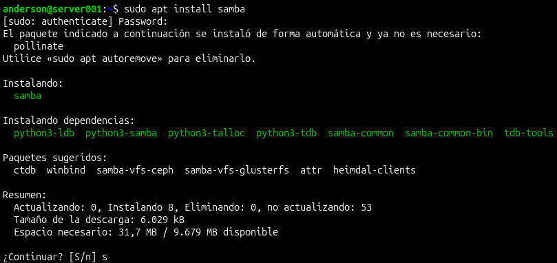

Para verificar, se lista el directorio de configuración que crea la instalación:

```bash
ls /etc/samba/
```

Aparece `smb.conf`, el archivo de configuración principal donde se definen los recursos compartidos.

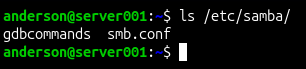

### 4.2 Creación de grupos y usuarios en Linux

Se crean los dos grupos y las cuatro cuentas, cada una dentro de su grupo:

```bash
sudo groupadd ventas
sudo groupadd marketing

sudo useradd -M -s /usr/sbin/nologin -G ventas carlos
sudo useradd -M -s /usr/sbin/nologin -G ventas laura
sudo useradd -M -s /usr/sbin/nologin -G marketing marta
sudo useradd -M -s /usr/sbin/nologin -G marketing pedro
```

| Opción | Efecto |
|---|---|
| `-M` | No crea carpeta personal: las cuentas solo se usan para Samba. |
| `-s /usr/sbin/nologin` | Impide abrir sesión en el servidor (principio de mínimo privilegio). |
| `-G <grupo>` | Añade la cuenta al grupo indicado. |

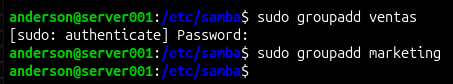

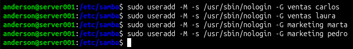

Comprobación de la pertenencia a los grupos:

```bash
getent group ventas marketing
id carlos
```

`ventas` contiene a `carlos` y `laura`, y `marketing` a `marta` y `pedro`. Ubuntu crea además un grupo personal por cada usuario, que es su grupo principal.

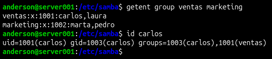

### 4.3 Registro de los usuarios en Samba

Cada usuario debe existir ya en Linux. El comando pide la contraseña dos veces:

```bash
sudo smbpasswd -a carlos
sudo smbpasswd -a laura
sudo smbpasswd -a marta
sudo smbpasswd -a pedro
sudo pdbedit -L
```

- `smbpasswd -a` añade al usuario a la base de datos de Samba y le asigna su contraseña de Samba.
- `pdbedit -L` lista los usuarios registrados (formato `usuario:UID:`).

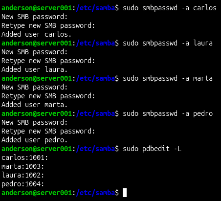

### 4.4 Carpeta compartida y permisos en Linux

```bash
sudo mkdir -p /srv/samba/ventas
sudo chown root:ventas /srv/samba/ventas
sudo chmod 2775 /srv/samba/ventas
ls -ld /srv/samba/ventas
```

| Dígito de `2775` | Para quién | Efecto |
|---|---|---|
| `2` (setgid) | Carpeta | Lo que se cree dentro hereda el grupo `ventas`. |
| `7` | Dueño (`root`) | Leer, escribir y entrar. |
| `7` | Grupo `ventas` | Leer, escribir y entrar: `carlos` y `laura` pueden editar. |
| `5` | Otros | Leer y entrar, sin escribir: `marta` y `pedro` solo ven. |

El resultado `drwxrwsr-x root ventas` confirma el dueño, el grupo y el setgid (la `s`).

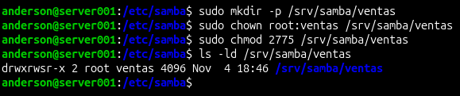

### 4.5 Configuración de `smb.conf`

Se edita el archivo y se agrega una sección al final:

```bash
sudo nano /etc/samba/smb.conf
```

```ini
[ventas]
   comment = Documentos del departamento de ventas
   path = /srv/samba/ventas
   browseable = yes
   guest ok = no
   read only = yes
   valid users = @ventas, @marketing
   write list = @ventas
   create mask = 0664
   directory mask = 2775
```

| Parámetro | Función |
|---|---|
| `[ventas]` | Nombre del recurso en la red (`\\IP\ventas`). |
| `path` | Carpeta real del servidor. |
| `browseable = yes` | El recurso aparece al navegar el servidor. |
| `guest ok = no` | No se permite entrar sin usuario y contraseña. |
| `read only = yes` | Por defecto, todos entran solo con lectura. |
| `valid users = @ventas, @marketing` | Solo los miembros de estos grupos pueden entrar. La `@` indica un grupo. |
| `write list = @ventas` | Excepción: los miembros de `ventas` sí pueden escribir. |
| `create mask = 0664` | Permisos de los archivos nuevos: dueño y grupo leen y escriben, otros solo leen. |
| `directory mask = 2775` | Permisos de las carpetas nuevas. |

![Sección [ventas] en smb.conf](capturas/08-editar_archivo.png)

**Validación de la sintaxis.** Antes de aplicar el cambio se comprueba el archivo:

```bash
testparm -s
```

Muestra `Loaded services file OK.` y la sección `[ventas]` con los valores interpretados. Solo se listan los parámetros que difieren de los valores por defecto, por eso no aparecen `browseable`, `guest ok` ni `read only`. El aviso `Weak crypto is allowed` es informativo, no un error.

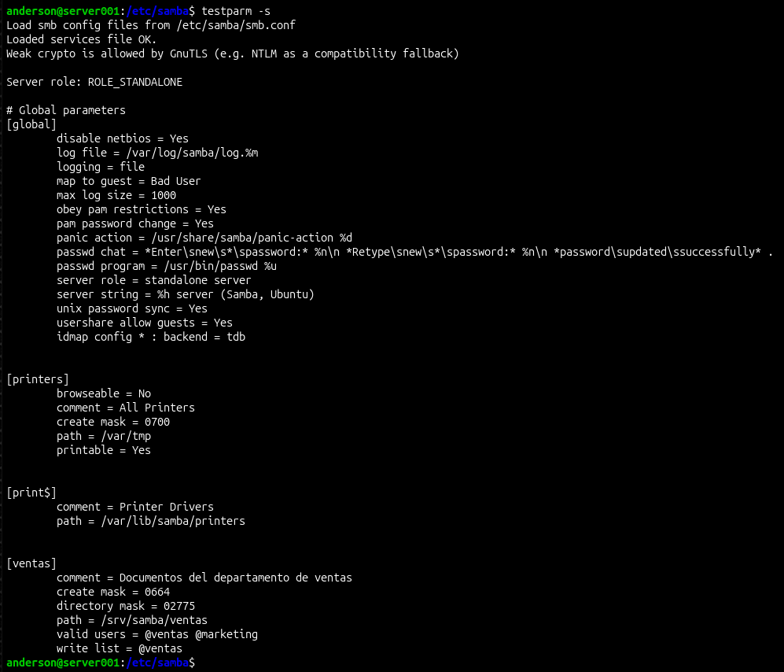

### 4.6 Reinicio del servicio

```bash
sudo systemctl restart smbd
sudo systemctl status smbd
```

`restart` obliga a Samba a leer la configuración nueva. El estado `active (running)` y el mensaje `ready to serve connections` indican que el servidor está listo. El estado `enabled` significa que arrancará solo al encender el equipo.

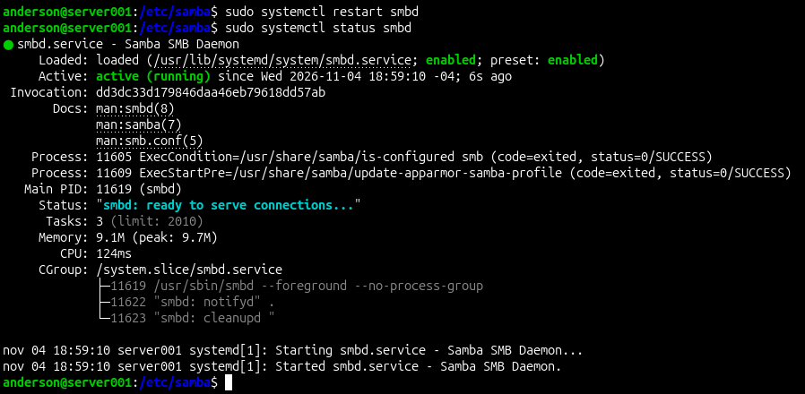

---

## 5. Resultados de las pruebas

Las pruebas se hacen desde Windows con las cuatro cuentas. Windows solo admite **un usuario por servidor a la vez** en la misma sesión, así que antes de cambiar de cuenta se cierra la conexión anterior:

```cmd
net use \\192.168.1.106\ventas /delete
net use \\192.168.1.106\ventas /user:<usuario>
```

### Resumen

| Cuenta | Grupo | Prueba | Esperado | Resultado | Capturas |
|---|---|---|---|---|---|
| `carlos` | ventas | Crear carpeta y archivo, y editarlo | Permitido | ✅ Permitido | 11, 12 |
| `marta` | marketing | Leer el archivo / guardar cambios | Leer sí, guardar no | ✅ Lee, guardar denegado | 13, 14 |
| `laura` | ventas | Editar un archivo creado por `carlos` | Permitido | ✅ Permitido | 15, 16 |
| `pedro` | marketing | Crear contenido en el recurso | Denegado | ✅ Denegado | 18, 19 |

### 5.1 Carlos (ventas): puede editar

Se conecta con su cuenta y desde el Explorador accede a `\\192.168.1.106\ventas`. Crea la carpeta `Archivos_empresa` y dentro el archivo `archivo_prueba.txt`.

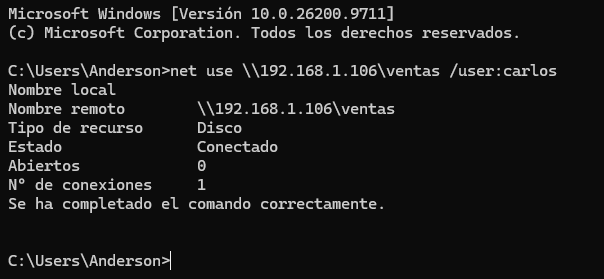

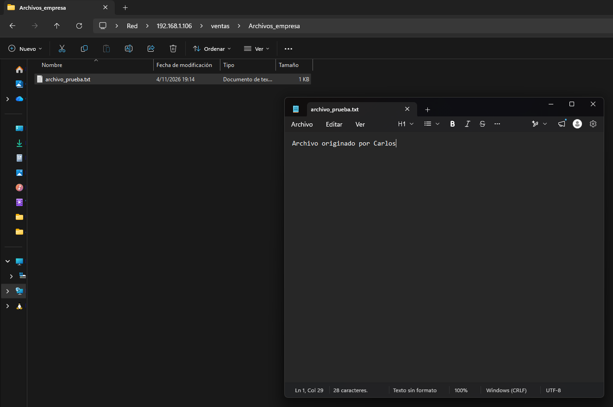

### 5.2 Marta (marketing): solo lectura

Se cierra la conexión de Carlos y se conecta como `marta`. Puede abrir el archivo y ver su contenido, pero al intentar guardar un cambio el Bloc de notas indica que no tiene permiso. El archivo no se modifica: su fecha de modificación sigue siendo la de Carlos.

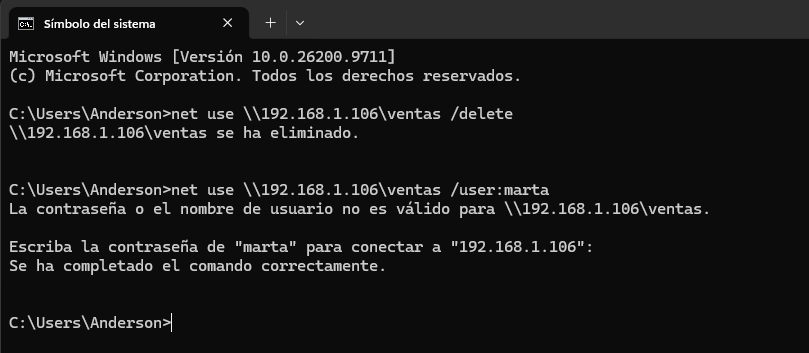

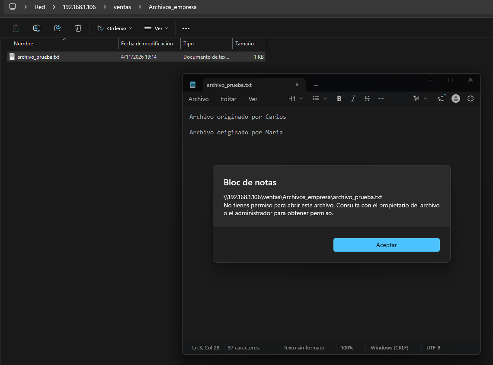

> En esta captura el texto añadido por error dice «María», pero la cuenta usada es `marta`.

### 5.3 Laura (ventas): edita un archivo ajeno

Se conecta como `laura` y modifica el archivo creado por Carlos. El cambio se guarda sin errores y la fecha de modificación se actualiza. Esto demuestra que el permiso lo da el **grupo** `ventas`, no el dueño del archivo.

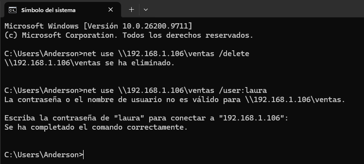

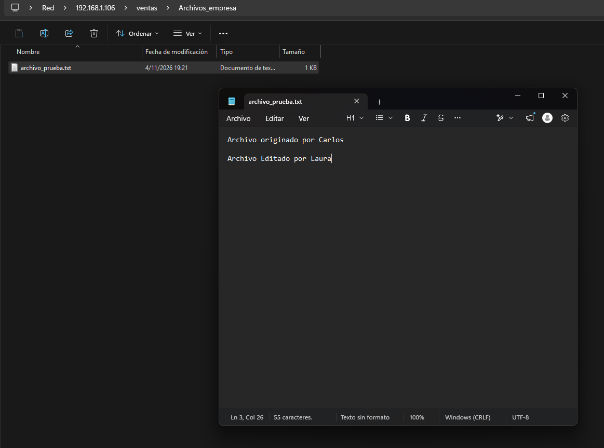

### 5.4 Verificación desde el servidor

Se revisan los permisos reales del archivo y de la carpeta:

```bash
ls -l /srv/samba/ventas/Archivos_empresa
ls -ld /srv/samba/ventas/Archivos_empresa
```

| Elemento | Permisos | Dueño y grupo | Explicación |
|---|---|---|---|
| `archivo_prueba.txt` | `-rw-rw-r--` | `carlos` / `ventas` | Resultado de `create mask = 0664`. El grupo `ventas` puede escribir. |
| `Archivos_empresa` | `drwxrwsr-x` | `carlos` / `ventas` | La `s` indica setgid: lo creado dentro conserva el grupo. |

El dueño sigue siendo `carlos` aunque `laura` haya editado el archivo: quien le permite escribir es el grupo, no la propiedad.

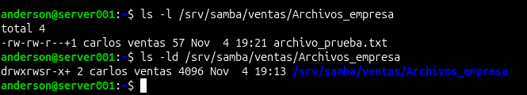

### 5.5 Pedro (marketing): solo lectura

Se conecta como `pedro`. Puede entrar al recurso y ver la carpeta `Archivos_empresa`, pero al intentar crear contenido Windows responde «Acceso a la carpeta de destino denegado».

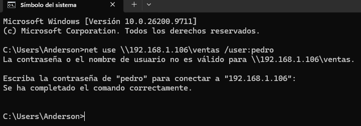

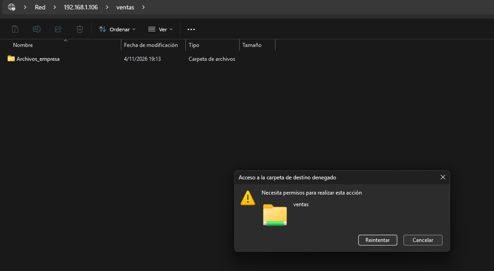

La denegación se aplica en las dos capas: `write list` de Samba no incluye al grupo `marketing`, y en Linux ese grupo solo entra por «otros», que no tiene permiso de escritura.

---

## 6. Problemas encontrados

### El Explorador no encontraba el recurso

Al escribir `\\192.168.1.106\ventas` en el Explorador, Windows respondía que no encontraba la ruta. Se descartó la red por pasos:

| Prueba | Resultado | Conclusión |
|---|---|---|
| `ping 192.168.1.106` desde Windows | Responde | El servidor es alcanzable. |
| `Test-NetConnection 192.168.1.106 -Port 445` (PowerShell) | `TcpTestSucceeded: True` | El puerto SMB está abierto. |
| `sudo ufw status` en el servidor | `inactive` | No hay firewall bloqueando. |
| `net use \\192.168.1.106\ventas /user:carlos` | Se completó correctamente | Samba, usuarios y recurso funcionan. |

El Explorador muestra un mensaje genérico y no indica la causa real. La conexión desde la línea de comandos, indicando la cuenta, funcionó. Una vez establecida, el Explorador pudo abrir el recurso.

### Un usuario por servidor en Windows

Windows no permite mantener dos conexiones con distintas cuentas al mismo servidor. Para cambiar de usuario hay que cerrar la conexión con `net use ... /delete`.

### Aviso de credenciales inválidas antes de la contraseña

Al conectar con una cuenta nueva, Windows primero intenta usar las credenciales que ya tenía para ese servidor, y muestra «La contraseña o el nombre de usuario no es válido». Después pide la contraseña de la cuenta indicada y la conexión se completa.

### El signo `+` en los permisos

`ls -l` muestra `-rw-rw-r--+`. El signo indica que existe una ACL asociada. Al consultarla con `getfacl`, solo contiene las tres entradas básicas (dueño, grupo y otros), iguales a los permisos normales, sin permisos adicionales para ningún usuario ni para `marketing`.

---

## 7. Conclusiones

- Samba permite que un servidor Linux ofrezca carpetas a clientes Windows, con **una sola copia** de los archivos en el servidor.
- Los usuarios del servidor **son independientes** de las cuentas de las PC de los clientes: hay que crearlos en Linux y registrarlos en Samba.
- Samba guarda sus contraseñas en una base de datos propia, distinta de la de Linux.
- Los **grupos** simplifican la administración: los permisos se asignan al grupo y no a cada persona.
- El acceso depende de **dos capas**, Samba y los permisos de Linux, que deben ser coherentes.
- El `setgid` de la carpeta garantiza que los archivos nuevos conserven el grupo `ventas`, y así los miembros del grupo pueden editar el trabajo de los demás.

## 8. Resumen de comandos

| Comando | Función |
|---|---|
| `sudo apt install samba` | Instala Samba. |
| `sudo groupadd <grupo>` | Crea un grupo. |
| `sudo useradd -M -s /usr/sbin/nologin -G <grupo> <usuario>` | Crea una cuenta sin carpeta personal ni acceso al sistema, dentro de un grupo. |
| `getent group <grupo>` / `id <usuario>` | Muestra miembros de un grupo o los grupos de un usuario. |
| `sudo smbpasswd -a <usuario>` | Registra al usuario en Samba y asigna su contraseña. |
| `sudo pdbedit -L` | Lista los usuarios de Samba. |
| `sudo chown root:ventas <ruta>` | Asigna dueño y grupo. |
| `sudo chmod 2775 <ruta>` | Asigna permisos con setgid. |
| `testparm -s` | Valida la sintaxis de `smb.conf`. |
| `sudo systemctl restart smbd` | Reinicia el servicio de Samba. |
| `sudo systemctl status smbd` | Muestra el estado del servicio. |
| `net use \\IP\recurso /user:<usuario>` | Conecta a un recurso compartido desde Windows. |
| `net use \\IP\recurso /delete` | Cierra la conexión a un recurso. |
| `getfacl <ruta>` | Muestra la ACL de un archivo o carpeta. |

## 9. Estructura del repositorio

```
samba/
├── README.md
└── capturas/
    ├── 01-instalar_samba.png
    ├── 02-verificar_instalacion.png
    ├── 03-crear_grupos.png
    ├── 04-crear_usuarios_minimo.png
    ├── 05-comprobar.png
    ├── 06-crear_usuarios_contrasenas_en_samba.png
    ├── 07-crear_carpeta.png
    ├── 08-editar_archivo.png
    ├── 09-archivo_sin_errores.png
    ├── 10-reiniciar_comprobar.png
    ├── 11-conectar_carlos.png
    ├── 12-carlos_conectado.png
    ├── 13-conectar_marta.png
    ├── 14-marta_no_puede_escribir.png
    ├── 15-conectar_laura.png
    ├── 16-laura_edita.png
    ├── 17-vista_desde_servidor.png
    ├── 18-conectar_pedro.png
    └── 19-pedro_no_puede_crear.png
```
