# Laboratorio DHCP con Relay Agent en GNS3

Red corporativa de cinco sitios con **DHCP local** en la sede central y un **servidor DHCP centralizado** que atiende al resto de las sucursales mediante **DHCP Relay**. El enrutamiento entre sitios se hace con **RIPv2** y el enrutamiento entre VLANs con **Router-on-a-Stick (ROAS)**.

---

## Tabla de contenido

1. [Objetivos](#objetivos)
2. [Herramientas y tecnologías](#herramientas-y-tecnologías)
3. [Requisitos para abrir el proyecto](#requisitos-para-abrir-el-proyecto)
4. [Topología](#topología)
5. [Plan de direccionamiento](#plan-de-direccionamiento)
6. [Parámetros DHCP](#parámetros-dhcp)
7. [Cómo funciona el relay en esta red](#cómo-funciona-el-relay-en-esta-red)
8. [Implementación y evidencias](#implementación-y-evidencias)
9. [Verificación final](#verificación-final)
10. [Notas para reproducir el laboratorio](#notas-para-reproducir-el-laboratorio)
11. [Conclusiones](#conclusiones)
12. [Estructura del repositorio](#estructura-del-repositorio)

---

## Objetivos

- Configurar un servidor DHCP local en un router y entregar direcciones a tres VLANs.
- Centralizar el DHCP de las demás sucursales en un único servidor ubicado en **otra red**.
- Configurar **DHCP Relay** (`ip helper-address`) en las subinterfaces de usuarios de cada sucursal.
- Entregar por DHCP la máscara, el gateway, el servidor DNS, el dominio y un tiempo de préstamo (*lease*) distinto según la VLAN.
- Enrutar toda la red con **RIPv2** y comunicar las VLANs de cada sitio con **ROAS**.
- Verificar el funcionamiento con las tablas de asignaciones (*bindings*) y las estadísticas del servidor.

## Herramientas y tecnologías

| Elemento | Detalle |
|---|---|
| Simulador | GNS3 |
| Routers | Cisco 7200 (IOS 15.2) |
| Switches | Cisco IOU L2 (15.1g) |
| Clientes | VPCS |
| Enrutamiento | RIPv2 y ruta estática por defecto en el servidor |
| Conmutación | VLANs, troncales 802.1Q |
| Enrutamiento entre VLANs | Router-on-a-Stick (subinterfaces dot1q) |
| Servicios | DHCP (servidor local, servidor centralizado y relay) |

---

## Requisitos para abrir el proyecto

El laboratorio se entrega como `Lab_dhcp.gns3project`, un **proyecto portable** de GNS3. No incluye las imágenes de los dispositivos, porque tienen licencia y no se distribuyen en este repositorio, así que cada persona debe aportar las suyas.

| Requisito | Detalle |
|---|---|
| GNS3 con **GNS3 VM** | Necesaria para ejecutar los switches IOU |
| Imagen de los routers | Cisco 7200: `c7200-advipservicesk9-mz.152-4.S5.bin` |
| Imagen de los switches | Cisco IOU L2: `i86bi-linux-l2-ipbasek9-15.1g.bin` |
| Licencia de IOU | Archivo `iourc` propio, configurado en GNS3 |

**Pasos para abrirlo:**

1. Registrar en GNS3 las imágenes de los routers y de los switches como plantillas (*templates*).
2. Importar el proyecto desde *File → Import portable project* y seleccionar `Lab_dhcp.gns3project`.
3. Antes de encender la topología, leer las [notas para reproducir el laboratorio](#notas-para-reproducir-el-laboratorio).

---

## Topología

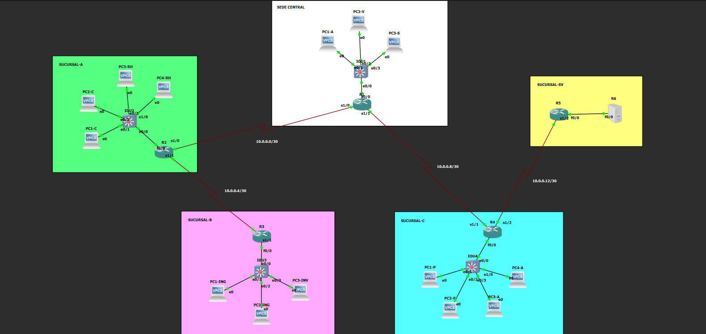

| Router | Sitio | VLANs | Rol DHCP |
|---|---|---|---|
| R1 | Sede Central | 10, 20, 30 | Servidor DHCP local |
| R2 | Sucursal A | 40, 50 | Relay hacia el servidor |
| R3 | Sucursal B | 60, 70 | Relay hacia el servidor |
| R4 | Sucursal C | 80, 90 | Relay hacia el servidor |
| R5 | Sucursal SV | (ninguna) | Router de acceso a la red de servidores |
| R6 (`DHCP-SVR`) | Sucursal SV | (ninguna) | Servidor DHCP centralizado |

El servidor DHCP es un router (R6) con el icono cambiado a servidor. Está **detrás de R5**, en una red propia, así que cualquier petición de las sucursales tiene que cruzar varios routers para llegar hasta él.

---

## Plan de direccionamiento

### VLANs y redes de usuarios

El ID de cada VLAN coincide con el tercer octeto de su red. El gateway de cada una es la dirección `.1`, que corresponde a la subinterfaz del router.

| Sitio | VLAN | Nombre | Red | Gateway |
|---|---|---|---|---|
| Sede Central (R1) | 10 | Administracion | 192.168.10.0/24 | 192.168.10.1 |
| Sede Central (R1) | 20 | Ventas | 192.168.20.0/24 | 192.168.20.1 |
| Sede Central (R1) | 30 | Soporte | 192.168.30.0/24 | 192.168.30.1 |
| Sucursal A (R2) | 40 | Contabilidad | 192.168.40.0/24 | 192.168.40.1 |
| Sucursal A (R2) | 50 | RRHH | 192.168.50.0/24 | 192.168.50.1 |
| Sucursal B (R3) | 60 | Ingenieria | 192.168.60.0/24 | 192.168.60.1 |
| Sucursal B (R3) | 70 | Invitados | 192.168.70.0/24 | 192.168.70.1 |
| Sucursal C (R4) | 80 | Produccion | 192.168.80.0/24 | 192.168.80.1 |
| Sucursal C (R4) | 90 | Almacen | 192.168.90.0/24 | 192.168.90.1 |

### Enlaces entre routers (seriales /30)

| Enlace | Red | Interfaz A | Interfaz B |
|---|---|---|---|
| R1 ↔ R2 | 10.0.0.0/30 | R1 S1/0 | R2 S1/0 |
| R2 ↔ R3 | 10.0.0.4/30 | R2 S1/1 | R3 S1/1 |
| R1 ↔ R4 | 10.0.0.8/30 | R1 S1/1 | R4 S1/1 |
| R4 ↔ R5 | 10.0.0.12/30 | R4 S1/2 | R5 S1/2 |

### Red de servidores

| Dispositivo | Interfaz | Dirección |
|---|---|---|
| R5 | F0/0 | 172.16.100.1/24 |
| R6 (`DHCP-SVR`) | F0/0 | 172.16.100.2/24 |

---

## Parámetros DHCP

Los parámetros viajan en el Offer y el Ack como **opciones DHCP**.

| Parámetro | Opción | Valor |
|---|---|---|
| Máscara de subred | 1 | 255.255.255.0 |
| Gateway | 3 | `.1` de cada VLAN |
| Servidor DNS | 6 | 8.8.8.8 |
| Dominio | 15 | empresa.local |
| Tiempo de préstamo | 51 | Ver tabla siguiente |
| Direcciones excluidas | — | `.1` a `.10` en cada red |

| VLAN | Tiempo de préstamo | Motivo |
|---|---|---|
| 10, 20, 30, 40, 50, 60 | 1 día | Puestos de trabajo fijos |
| 80, 90 | 8 horas | Turnos de producción y almacén |
| 70 | 2 horas | Invitados: entran y salen, así que las IPs vuelven rápido al pool |

---

## Cómo funciona el relay en esta red

El mensaje Discover de un cliente es un **broadcast**, y un broadcast no cruza routers. Por eso, en las sucursales, el router del sitio actúa como **relay**: recibe el broadcast, lo convierte en **unicast** hacia el servidor y escribe en el campo **giaddr** la IP de la subinterfaz por la que lo recibió.

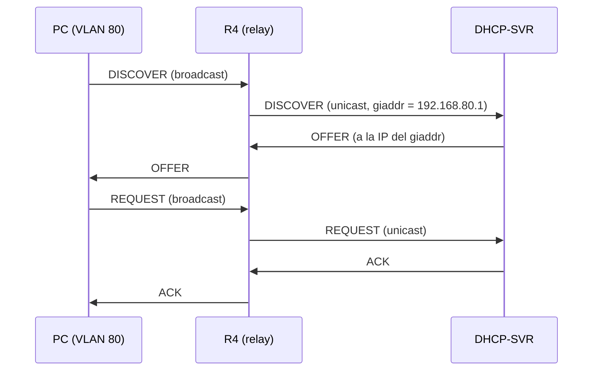

El servidor usa el **giaddr** para dos cosas:

1. **Elegir el pool correcto**: compara el giaddr con la red de cada pool, y así entrega una IP del rango de la VLAN de ese cliente.
2. **Saber a dónde devolver la respuesta**: el origen original del cliente era `0.0.0.0`, así que responde a la IP del giaddr, y el relay entrega el mensaje al cliente.

El servidor (R6) solo necesita una **ruta por defecto hacia R5** para poder devolver las respuestas hacia cualquier VLAN.

---

## Implementación y evidencias

### Fase 1: VLANs y troncal en los switches

Las VLANs se crean con su ID y nombre; los puertos de los PCs quedan como acceso, y el puerto hacia el router, como troncal 802.1Q.

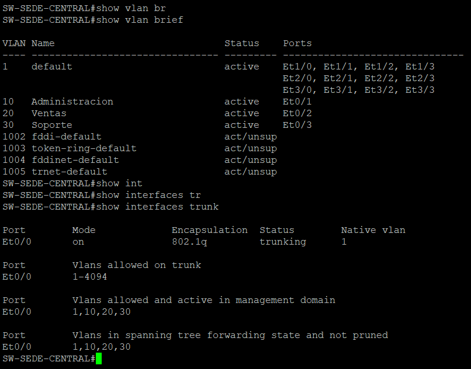

El switch de la Sede Central tiene las VLANs 10, 20 y 30 en los puertos Et0/1 a Et0/3, y el puerto Et0/0 trabaja como troncal 802.1Q con esas VLANs activas.

### Fase 2: Router-on-a-Stick

La interfaz física no lleva IP; cada VLAN tiene una subinterfaz con su gateway.

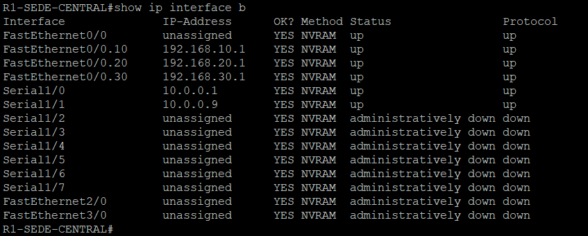

En R1, las subinterfaces `FastEthernet0/0.10`, `.20` y `.30` están en up/up con los gateways 192.168.10.1, 192.168.20.1 y 192.168.30.1. Los seriales Serial1/0 y Serial1/1 son los enlaces hacia R2 y R4.

### Fase 3: Enrutamiento RIPv2

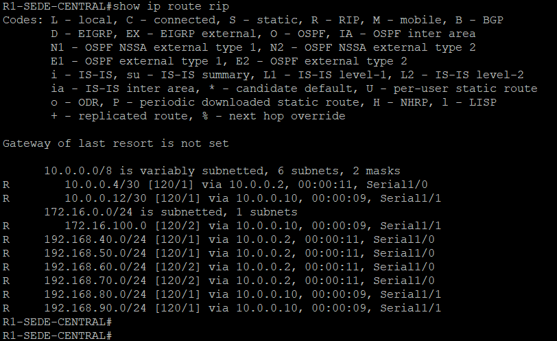

R1 aprende por RIP las redes de todas las VLANs remotas (40 a 90), los enlaces que no son suyos y la red de servidores `172.16.100.0/24`, que está a dos saltos vía R4.

El servidor no participa en RIP: usa una ruta estática por defecto hacia R5.

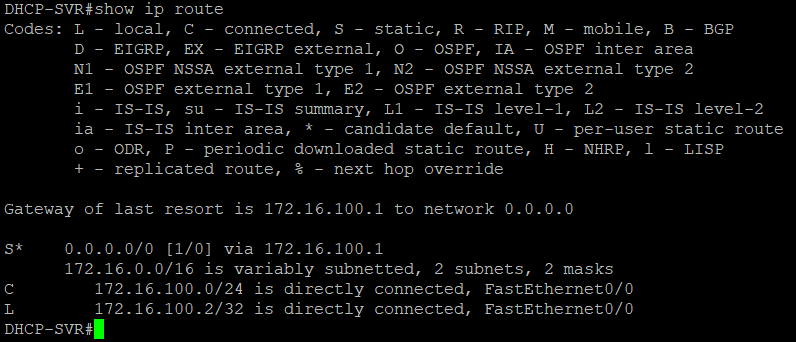

La puerta de enlace de último recurso de `DHCP-SVR` es `172.16.100.1` (R5).

### Fase 4: DHCP local en R1

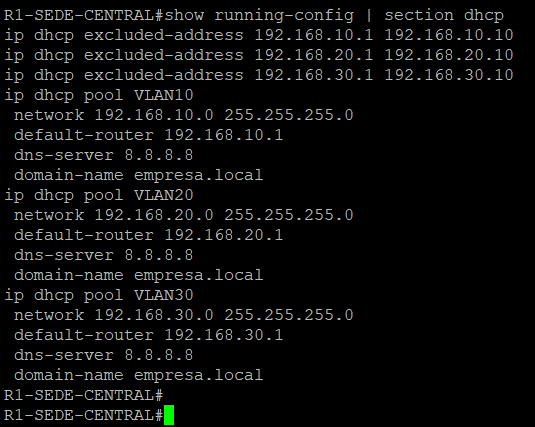

R1 tiene tres pools (`VLAN10`, `VLAN20` y `VLAN30`), cada uno con su red, gateway, DNS `8.8.8.8` y dominio `empresa.local`, y con las direcciones `.1` a `.10` excluidas.

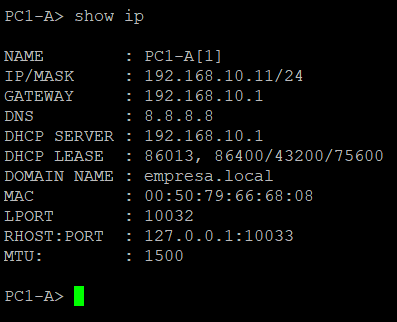

`PC1-A` recibió `192.168.10.11/24` con el servidor DHCP `192.168.10.1` (el propio R1) y un préstamo de 86400 segundos (1 día).

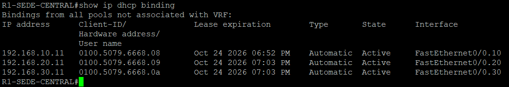

La tabla de asignaciones de R1 muestra un cliente por cada VLAN local, con la subinterfaz por la que se atendió.

### Fase 5: Servidor DHCP centralizado

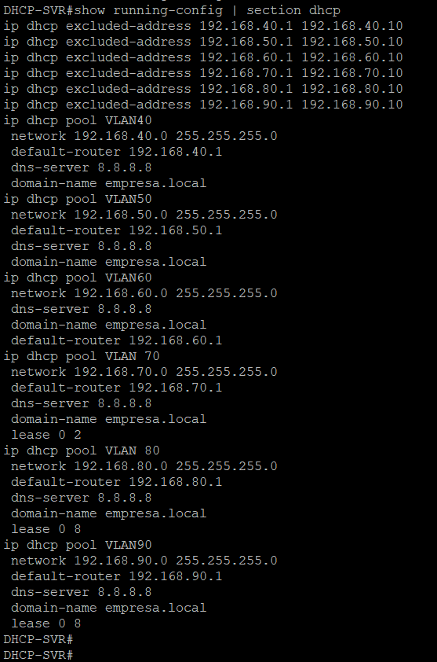

`DHCP-SVR` tiene **seis pools**, uno por cada VLAN de las sucursales (40 a 90), con las direcciones `.1` a `.10` excluidas. La VLAN 70 tiene un préstamo de 2 horas, las VLANs 80 y 90, de 8 horas, y el resto usa el valor por defecto de 1 día.

### Fase 6: DHCP Relay en las sucursales

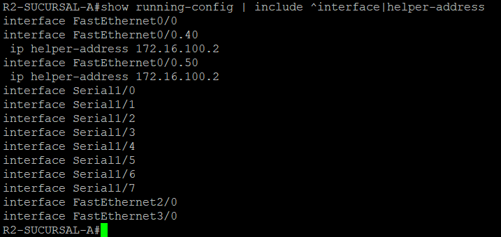

En R2, las subinterfaces de las VLANs de usuarios (`FastEthernet0/0.40` y `.50`) apuntan con `ip helper-address` a `172.16.100.2`. Los enlaces seriales no llevan relay, porque no reciben broadcasts de clientes.

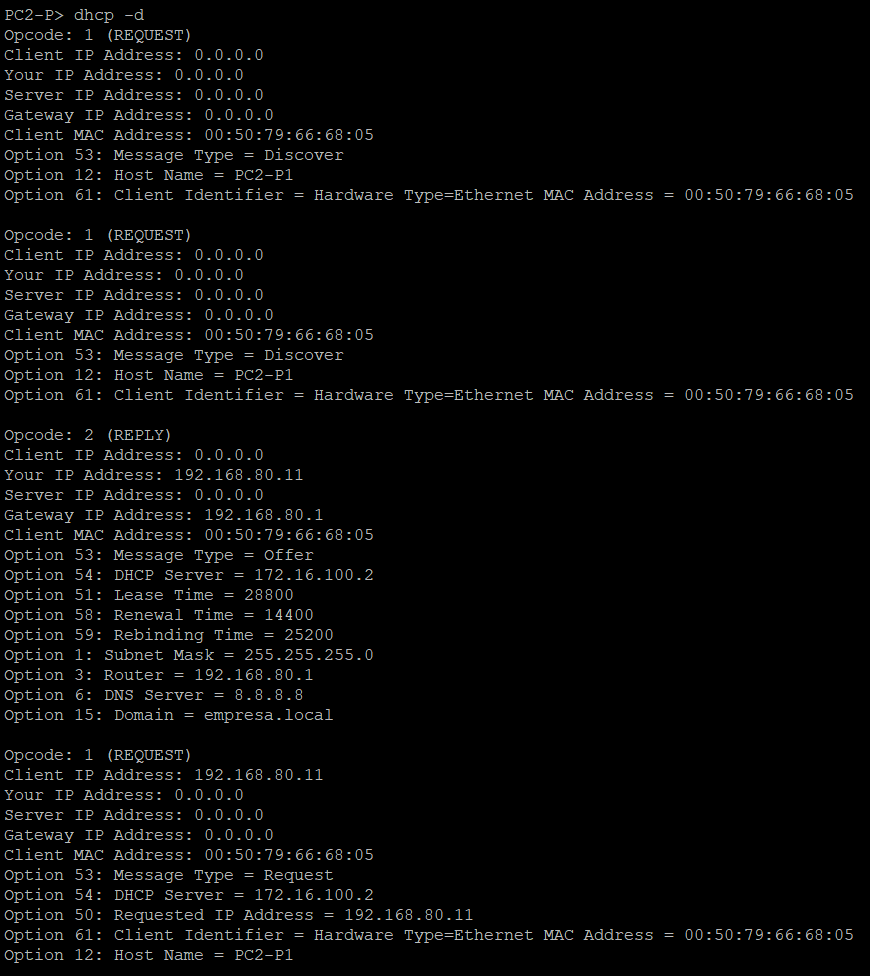

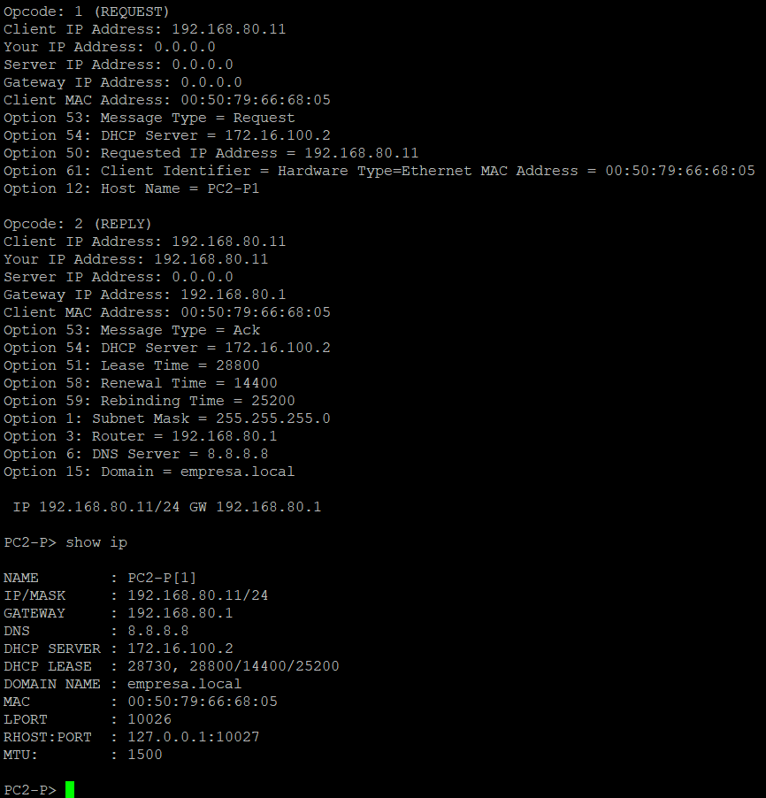

`PC2-P` (VLAN 80, Sucursal C) ejecutó `dhcp -d`, que muestra los mensajes del proceso:

- El **Discover** sale con `Gateway IP Address: 0.0.0.0`.
- En el **Offer** y en el **Ack** el mismo campo vale `192.168.80.1`. Es el **giaddr** que escribió el relay, es decir, la IP de la subinterfaz de la VLAN 80 en R4.
- El servidor que responde es `172.16.100.2`, a pesar de que el PC está en la VLAN 80.
- El préstamo es de `28800` segundos (8 horas), como se configuró para esa VLAN.

---

## Verificación final

### Comparación entre DHCP local y DHCP con relay

| Aspecto | Cliente local (`PC1-A`) | Cliente con relay (`PC2-P`) |
|---|---|---|
| Servidor DHCP | 192.168.10.1 (R1) | 172.16.100.2 (`DHCP-SVR`) |
| Préstamo | 86400 s (1 día) | 28800 s (8 horas) |
| Campo giaddr en las respuestas | No hay relay de por medio | 192.168.80.1 (escrito por el relay) |

### Asignaciones en el servidor central

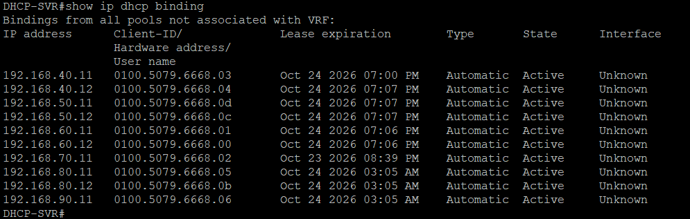

El servidor tiene **10 asignaciones activas** repartidas en las seis VLANs de las sucursales. Los vencimientos reflejan los préstamos de cada pool: las IPs de la VLAN 70 vencen antes que las de las VLANs 80 y 90, y estas, antes que las de las VLANs 40, 50 y 60.

### Estadísticas del servidor

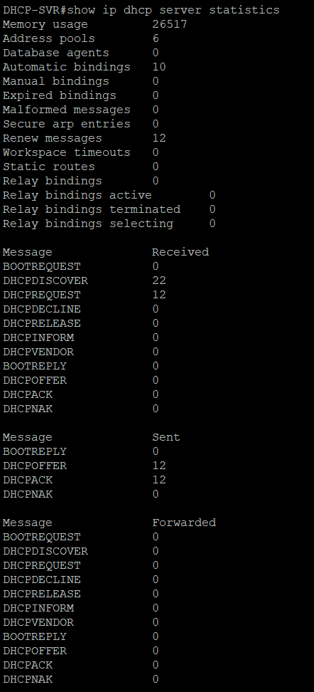

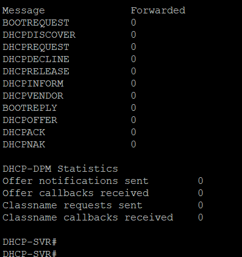

| Indicador | Valor |
|---|---|
| Pools de direcciones | 6 |
| Asignaciones automáticas | 10 |
| DHCPDISCOVER recibidos | 22 |
| DHCPREQUEST recibidos | 12 |
| DHCPOFFER enviados | 12 |
| DHCPACK enviados | 12 |
| DHCPNAK enviados | 0 |
| Mensajes mal formados | 0 |

Los contadores de *Forwarded* están en cero porque el servidor atiende las peticiones directamente. El reenvío lo hacen los relays de cada sucursal.

### Conectividad entre VLANs de sitios distintos

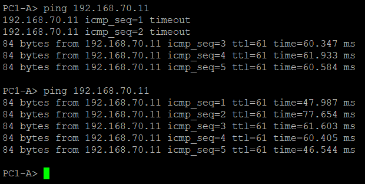

`PC1-A` (VLAN 10, Sede Central) llega a `192.168.70.11` (VLAN 70, Sucursal B), un equipo que obtuvo su IP por relay. El TTL de 61 indica que el paquete atravesó tres routers (R1, R2 y R3). Los primeros paquetes del primer ping se pierden mientras se resuelven las tablas ARP, y el segundo ping responde sin pérdidas.

### Comandos de verificación utilizados

| Comando | Dispositivo | Qué comprueba |
|---|---|---|
| `show vlan brief` / `show interfaces trunk` | Switch | VLANs y troncal |
| `show ip interface brief` | Router | Estado y direcciones de las subinterfaces |
| `show ip route rip` | Router | Rutas aprendidas por RIPv2 |
| `show running-config \| section dhcp` | R1 y servidor | Pools, exclusiones y préstamos |
| `show running-config \| include ^interface\|helper-address` | Relays | Subinterfaces con `ip helper-address` |
| `show ip dhcp binding` | R1 y servidor | Asignaciones activas |
| `show ip dhcp server statistics` | Servidor | Mensajes DHCP procesados |
| `ip dhcp -d` / `show ip` | PC (VPCS) | Proceso DORA y parámetros recibidos |

### Alcance de las evidencias

Este laboratorio **no incluye capturas de tráfico con Wireshark**. La presencia del relay se comprueba con el campo *Gateway IP Address* (giaddr) que muestra el propio cliente VPCS con `dhcp -d`, y con las tablas de asignaciones del servidor.

---

## Notas para reproducir el laboratorio

Estos dos puntos son comportamientos del simulador GNS3 y no del diseño de la red. Conviene tenerlos presentes antes de abrir la topología y probarla.

### 1. Dúplex de los switches

Aunque la configuración de los switches esté guardada, al abrir la topología los switches siguen operando en **half-duplex**, y si se fuerza `full-duplex` el valor vuelve a cambiar. Los routers, en cambio, sí mantienen `full-duplex`.

**Antes de probar la topología:**

1. Entrar a cada switch.
2. Acceder a la interfaz `Ethernet0/0`.
3. Configurar `full-duplex`.

### 2. Direcciones de los PCs (VPCS)

Las direcciones que reciben los PCs **se pierden al cerrar la topología**, aunque el proyecto esté guardado. Después de ajustar los switches, hay que volver a ejecutar `ip dhcp` en cada PC para que obtenga su dirección de nuevo.

### Orden recomendado para probar

1. Encender todos los nodos.
2. Ajustar el dúplex en `Ethernet0/0` de cada switch.
3. Ejecutar `ip dhcp` en cada PC.
4. Verificar con `show ip` en los PCs y con `show ip dhcp binding` en R1 y en `DHCP-SVR`.

---

## Conclusiones

- El **broadcast** del Discover no sale de su red local, y por eso se necesita un **relay** para centralizar el DHCP.
- El campo **giaddr** es la pieza clave: le dice al servidor de qué subred viene el cliente y a dónde devolver la respuesta.
- Un solo servidor puede atender muchas subredes, siempre que tenga **un pool por cada red** y una ruta de vuelta hacia ellas.
- Ajustar el **tiempo de préstamo** según el tipo de usuario (invitados, producción, oficina) evita agotar los pools con equipos que ya no están conectados.
- El relay se configura en las subinterfaces que **reciben el broadcast de los clientes**, no en los enlaces entre routers.

---

## Estructura del repositorio

```text
.
├── README.md
├── Lab_dhcp.gns3project
└── capturas/
    ├── 01-topologia.png
    ├── 02-vlans_y_trunk.png
    ├── 03-roas_subinterfaces.png
    ├── 04-rutas_rip.png
    ├── 05-ruta_default_servidor.png
    ├── 06-conectividad_extremo_a_extremo.png
    ├── 07-config_dhcp_r1.png
    ├── 08-config_dhcp_servidor.png
    ├── 09-config_relay.png
    ├── 10-cliente_dhcp_local.png
    ├── 11-cliente_dhcp_relay.png
    ├── 11.2-cliente_dhcp_relay.png
    ├── 12-binding_r1.png
    ├── 13-binding_servidor.png
    ├── 13.2-binding_servidor.png
    └── 13.3-binding_servidor.png
```
