# Laboratorio de NAT: un ISP, seis empresas y salida a internet

Laboratorio en **Cisco Packet Tracer** que simula algo cercano a la realidad: un proveedor de internet (**AndesNet**) con tres routers, seis empresas clientes con redes privadas distintas y un "internet" al fondo. Cada empresa traduce sus direcciones privadas a públicas en su router de borde, usando los cuatro tipos de NAT, y comparte sus servidores con el resto de las empresas a través de IP públicas.

> Las direcciones públicas de este laboratorio son **ficticias**. Solo son válidas dentro del simulador.

## Contenido

1. [Objetivo](#1-objetivo)
2. [Estructura del repositorio](#2-estructura-del-repositorio)
3. [Topología](#3-topología)
4. [Conceptos de NAT usados](#4-conceptos-de-nat-usados)
5. [Plan de direccionamiento](#5-plan-de-direccionamiento)
6. [El ISP: AndesNet](#6-el-isp-andesnet)
7. [EduNet: PAT y NAT estático](#7-edunet-pat-y-nat-estático)
8. [Sabores del Sur: NAT dinámico](#8-sabores-del-sur-nat-dinámico)
9. [ModaViva y FinanSur: NAT dinámico con sobrecarga](#9-modaviva-y-finansur-nat-dinámico-con-sobrecarga)
10. [GameZone: RIP interno y PAT](#10-gamezone-rip-interno-y-pat)
11. [TecnoNova: RIP con cuatro routers y PAT](#11-tecnonova-rip-con-cuatro-routers-y-pat)
12. [El mismo rango privado en dos empresas](#12-el-mismo-rango-privado-en-dos-empresas)
13. [Salida a internet](#13-salida-a-internet)
14. [Las redes privadas no existen para internet](#14-las-redes-privadas-no-existen-para-internet)
15. [Servicios web y tráfico TCP](#15-servicios-web-y-tráfico-tcp)
16. [Comandos de verificación](#16-comandos-de-verificación)
17. [Conclusiones](#17-conclusiones)

---

## 1. Objetivo

Aplicar NAT en un escenario donde conviven **redes privadas y públicas**, y no solo en una red de una única empresa. El laboratorio busca demostrar que:

- Hosts con direcciones privadas pueden salir a internet y recibir respuestas gracias a la traducción en el router de borde.
- Los **cuatro tipos de NAT** (estático, dinámico, PAT y dinámico con sobrecarga) pueden convivir en una misma red, incluso dentro de un mismo router.
- Los servidores de las empresas son alcanzables desde afuera mediante **NAT estático**.
- El ISP **no conoce ninguna red privada** de sus clientes y aun así enruta todo el tráfico correctamente.
- Dos empresas pueden usar **el mismo rango privado** sin conflicto.

**Tecnologías aplicadas:** NAT estático, dinámico, PAT y dinámico con sobrecarga · ACL estándar · RIP v2 · rutas estáticas y rutas por defecto · rutas agregadas · VLAN y router-on-a-stick · servicios HTTP/HTTPS.

## 2. Estructura del repositorio

```text
NAT/
├── NAT.pkt          # Laboratorio de Packet Tracer
├── README.md        # Este documento
└── capturas/        # Evidencia de que el laboratorio funciona
```

## 3. Topología

La topología se divide en zonas: el **ISP** al centro, **seis empresas** conectadas por enlaces seriales públicos /30 y un recuadro de **proveedor** que simula el resto de internet.

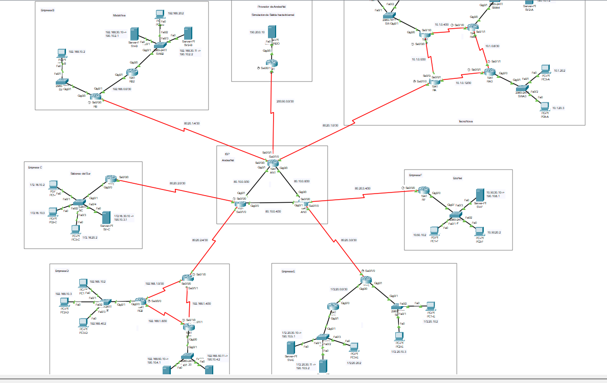

*Figura 1. Topología completa del laboratorio.*

| Empresa | Rubro | Router del ISP | Routers | Enrutamiento interno | NAT para usuarios | NAT para servidores |
|---|---|---|---|---|---|---|
| **A: TecnoNova** | Tecnología | AN1 | 4 | RIP | PAT | Estático |
| **B: ModaViva** | Ropa | AN1 | 2 | Rutas estáticas | Dinámico con sobrecarga | Estático |
| **C: Sabores del Sur** | Restaurante | AN2 | 1 | No aplica | Dinámico | Estático |
| **D: GameZone** | Videojuegos | AN2 | 3 | RIP | PAT | Estático |
| **E: FinanSur** | Finanzas | AN3 | 2 | Rutas estáticas | Dinámico con sobrecarga | Estático |
| **F: EduNet** | Educación | AN3 | 1 | No aplica | PAT | Estático |

## 4. Conceptos de NAT usados

### Por qué existe NAT

IPv4 tiene unos 4.300 millones de direcciones, insuficientes para todos los dispositivos. Por eso las organizaciones usan **direcciones privadas** (RFC 1918), que se repiten en miles de redes y **no se enrutan en internet**. El router de borde **traduce** la IP privada de origen por una pública al salir, y hace la traducción inversa al volver la respuesta. Para ello guarda una **tabla de traducción**.

### Los cuatro tipos de NAT

| Tipo | Cómo traduce | Dónde se usa en el laboratorio |
|---|---|---|
| **Estático (1:1)** | Una IP privada queda ligada a una IP pública de forma fija, en ambos sentidos | Los servidores de las seis empresas |
| **Dinámico** | Un pool de IP públicas se reparte a demanda, un host por IP y sin puertos | Sabores del Sur (C) |
| **PAT (sobrecarga)** | Una sola IP pública para muchos hosts, distinguidos por puerto | TecnoNova (A), GameZone (D) y EduNet (F) |
| **Dinámico con sobrecarga** | Un pool de IP públicas y cada una funciona como PAT | ModaViva (B) y FinanSur (E) |

La palabra clave es **`overload`**: cuando aparece, la traducción se reparte por puertos.

### Terminología: inside/outside, local/global

Cada dirección se nombra con dos preguntas: ¿de qué lado está el dispositivo (inside u outside)? y ¿desde dónde se mira (local = desde la red interna, global = desde internet)?

| Término | Significado |
|---|---|
| **Inside local** | Host interno visto desde la red interna (su IP privada) |
| **Inside global** | Host interno visto desde internet (la IP pública que lo representa) |
| **Outside local** | Host externo visto desde la red interna |
| **Outside global** | Host externo visto desde internet |

En la [sección 15](#15-servicios-web-y-tráfico-tcp) se ve una misma conversación con estos nombres en los dos routers.

### ACL estándar

Una ACL estándar numerada define **qué redes internas pueden ser traducidas** por el NAT dinámico o PAT. Se escribe con **wildcard mask**: el 0 significa "este octeto debe coincidir" y el 255 "puede ser cualquiera".

```text
access-list 1 permit 10.50.10.0 0.0.0.255
```

### Interfaces inside y outside

Todos los tipos de NAT necesitan marcar las interfaces: la que mira a la LAN lleva `ip nat inside` y la que mira al ISP lleva `ip nat outside`. En los routers con **router-on-a-stick**, **cada subinterfaz** de una VLAN necesita su propio `ip nat inside`. Si falta una, esa VLAN no sale a internet.

## 5. Plan de direccionamiento

### Núcleo del ISP (RIP v2)

| Enlace | Red | Extremo A | Extremo B |
|---|---|---|---|
| AN1 – AN2 | 80.10.0.0/30 | AN1 .1 | AN2 .2 |
| AN2 – AN3 | 80.10.0.4/30 | AN2 .5 | AN3 .6 |
| AN1 – AN3 | 80.10.0.8/30 | AN1 .9 | AN3 .10 |

### Enlaces públicos y bloques de cada cliente

Cada cliente tiene un **enlace /30** con el ISP y un **bloque público /29** que no está en el enlace. Dentro de cada bloque: **.1 y .2** son servidores (NAT estático) y **.3 y .4** son el pool de los clientes con NAT dinámico.

| Cliente | Enlace con el ISP | IP del ISP | IP del cliente | Bloque público |
|---|---|---|---|---|
| A: TecnoNova | 80.20.1.0/30 | AN1 .1 | .2 | 190.10.1.0/29 |
| B: ModaViva | 80.20.1.4/30 | AN1 .5 | .6 | 190.10.2.0/29 |
| C: Sabores del Sur | 80.20.2.0/30 | AN2 .1 | .2 | 190.10.3.0/29 |
| D: GameZone | 80.20.2.4/30 | AN2 .5 | .6 | 190.10.4.0/29 |
| E: FinanSur | 80.20.3.0/30 | AN3 .1 | .2 | 190.10.5.0/29 |
| F: EduNet | 80.20.3.4/30 | AN3 .5 | .6 | 190.10.6.0/29 |

### Redes privadas y servidores de cada empresa

| Empresa | Redes privadas | Servidores (IP privada → pública) |
|---|---|---|
| **A** | VLAN 10: 10.1.10.0/24 · VLAN 20: 10.1.20.0/24 · Servidores: 10.1.100.0/24 | 10.1.100.10 → 190.10.1.1 · 10.1.100.11 → 190.10.1.2 |
| **B** | VLAN 10: 192.168.10.0/24 · VLAN 20: 192.168.20.0/24 · Servidores: 192.168.30.0/24 | 192.168.30.10 → 190.10.2.1 · 192.168.30.11 → 190.10.2.2 |
| **C** | VLAN 10: 172.16.10.0/24 · VLAN 20: 172.16.20.0/24 · Servidores: 172.16.30.0/24 | 172.16.30.10 → 190.10.3.1 |
| **D** | VLAN 10: 192.168.10.0/24 · VLAN 40: 192.168.40.0/24 · Servidores: 192.168.50.0/24 | 192.168.50.10 → 190.10.4.1 · 192.168.50.11 → 190.10.4.2 |
| **E** | VLAN 10: 172.20.10.0/24 · VLAN 20: 172.20.20.0/24 · Servidores: 172.20.30.0/24 | 172.20.30.10 → 190.10.5.1 · 172.20.30.11 → 190.10.5.2 |
| **F** | VLAN 10: 10.50.10.0/24 · VLAN 20: 10.50.20.0/24 · Servidores: 10.50.30.0/24 | 10.50.30.10 → 190.10.6.1 |

> **B y D usan la misma red 192.168.10.0/24**, a propósito. Se comprueba en la [sección 12](#12-el-mismo-rango-privado-en-dos-empresas).

### Redes internas entre routers

| Empresa | Enlaces internos |
|---|---|
| A | 10.1.0.0/30, 10.1.0.4/30, 10.1.0.8/30 y 10.1.0.12/30 (forman un rombo) |
| B | 192.168.0.0/30 |
| D | 192.168.1.0/30, 192.168.1.4/30 y 192.168.1.8/30 (forman un triángulo) |
| E | 172.20.0.0/30 |

### Salida a internet

| Elemento | Dirección |
|---|---|
| Enlace AN1 – UP | 200.50.0.0/30 (UP .1 · AN1 .2) |
| Red del proveedor | 150.20.0.0/24 (UP .1) |
| Servidor "mundo" | 150.20.0.10 |

## 6. El ISP: AndesNet

Los tres routers del ISP se hablan por **RIP versión 2** (sin sumarización automática). Cada router anuncia sus redes conectadas, y las rutas hacia los bloques de los clientes se resuelven así:

- **Rutas estáticas** hacia el bloque de cada cliente, en el router que lo atiende, con el router del cliente como siguiente salto.
- **`redistribute static`** en RIP, para que los otros dos routers aprendan esas rutas.
- **Interfaces pasivas** hacia los clientes: el ISP no habla RIP con ellos.
- **Ruta por defecto** en AN1 hacia el proveedor, anunciada por RIP a AN2 y AN3.

```text
! Ejemplo en AN3
ip route 190.10.5.0 255.255.255.248 80.20.3.2
ip route 190.10.6.0 255.255.255.248 80.20.3.6
router rip
 version 2
 no auto-summary
 network 80.0.0.0
 redistribute static
 passive-interface Serial0/0/0
 passive-interface Serial0/1/0
```

La tabla de AN1 muestra la ruta por defecto (`S*`), las rutas estáticas hacia los bloques de A y B (`S`), los bloques de los demás clientes aprendidos por RIP (`R`) y **ninguna red privada**.

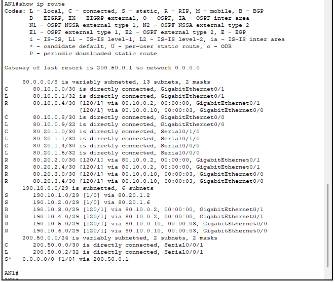

*Figura 2. `show ip route` en AN1.*

## 7. EduNet: PAT y NAT estático

EduNet tiene un solo router (RF), tres VLAN con router-on-a-stick y salida con **PAT** sobre la IP de la interfaz que da hacia el ISP (80.20.3.6). Su servidor web usa **NAT estático** (10.50.30.10 ↔ 190.10.6.1). Ambos conviven en el mismo router.

```text
access-list 1 permit 10.50.10.0 0.0.0.255
access-list 1 permit 10.50.20.0 0.0.0.255

ip nat inside source list 1 interface Serial0/0/0 overload
ip nat inside source static 10.50.30.10 190.10.6.1

interface GigabitEthernet0/0.10
 ip nat inside
interface Serial0/0/0
 ip nat outside
```

**Antes de aplicar PAT**, el ISP no podía devolver los paquetes de las PC privadas, porque no tiene ruta hacia 10.50.x.x. **Con PAT**, los paquetes salen con la IP del enlace (80.20.3.6), que el ISP sí conoce:

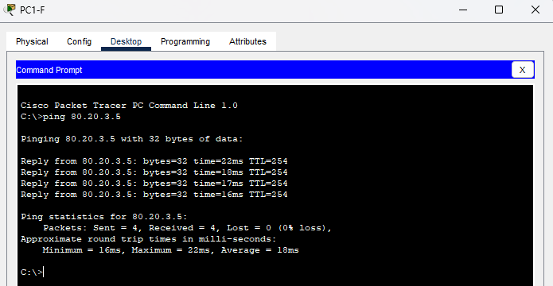

*Figura 3. PC1-F recibe respuesta de 80.20.3.5.*

La tabla de traducción de RF muestra las dos formas de NAT: las filas dinámicas de PAT, con **inside global 80.20.3.6**, y la entrada **estática** del servidor, sin puertos y permanente.

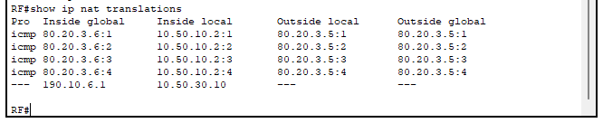

*Figura 4. `show ip nat translations` en RF.*

## 8. Sabores del Sur: NAT dinámico

Sabores del Sur usa **NAT dinámico puro**: un pool de **solo dos IP públicas** (190.10.3.3 y 190.10.3.4) y sin `overload`. Cada host que sale ocupa una IP completa. Con tres PC, la tercera no puede salir.

```text
ip nat pool PUBLICO 190.10.3.3 190.10.3.4 netmask 255.255.255.248
ip nat inside source list 1 pool PUBLICO
ip nat inside source static 172.16.30.10 190.10.3.1
```

Se lanzó un ping desde las tres PC casi a la vez. Las dos primeras salen y la tercera se queda sin respuesta (el primer paquete perdido de PC1-C es la resolución ARP del primer ping):

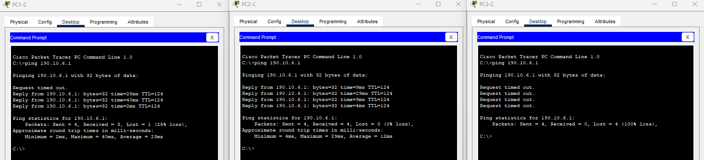

*Figura 5. PC1-C y PC2-C salen; PC3-C obtiene 100% de pérdida.*

La tabla de RC muestra primero solo la entrada estática y, tras el tráfico, las dos IP del pool asignadas, cada una a un host. Las estadísticas confirman el **agotamiento del pool**: 2 direcciones asignadas (100%) y contador de *misses*.

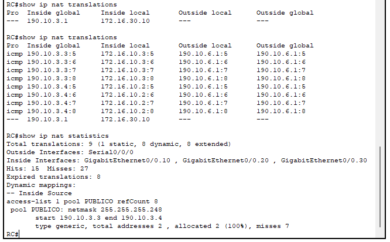

*Figura 6. `show ip nat translations` y `show ip nat statistics` en RC.*

## 9. ModaViva y FinanSur: NAT dinámico con sobrecarga

ModaViva (B) y FinanSur (E) tienen **dos routers** cada una, con **rutas estáticas**:

- El router de borde tiene rutas hacia las redes que están detrás del segundo router.
- El segundo router tiene una ruta por defecto hacia el borde.
- **El NAT va solo en el router de borde**, aunque los servidores estén detrás del segundo router. Las dos interfaces que dan hacia la LAN llevan `ip nat inside`.

Usan un pool de dos IP con **`overload`**: el router agota una IP del pool antes de pasar a la siguiente.

```text
ip nat pool PUBLICO 190.10.2.3 190.10.2.4 netmask 255.255.255.248
ip nat inside source list 1 pool PUBLICO overload
```

En la tabla de RB, hosts de la VLAN 10 y de la VLAN 20 salen **compartiendo la misma IP del pool** (190.10.2.3), y la 190.10.2.4 queda sin usar. Abajo aparecen las dos entradas estáticas de los servidores. A diferencia del NAT dinámico puro, aquí tres hosts no agotan el pool: el límite son las conexiones, no los hosts.

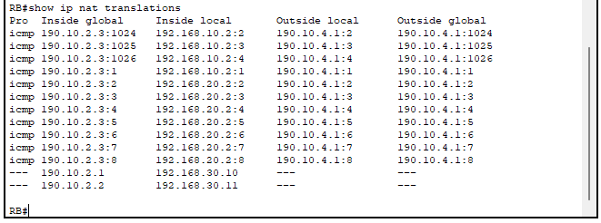

*Figura 7. `show ip nat translations` en RB.*

## 10. GameZone: RIP interno y PAT

GameZone tiene **tres routers** conectados en triángulo con seriales. Los routers internos aprenden las rutas por **RIP v2**. El router de borde (RD) tiene una ruta por defecto hacia el ISP y la **anuncia hacia dentro por RIP**, así los demás no necesitan una ruta estática propia.

El router de las VLAN 10 y 40 aprende la ruta por defecto por RIP (`R*`), sin que se haya configurado a mano:

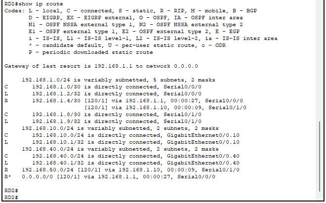

*Figura 8. `show ip route` en RD2: `R* 0.0.0.0/0` vía 192.168.1.1.*

Al usar RIP en una empresa hay que impedir que **se asome al ISP**. En RD, RIP solo anuncia la red 192.168.1.0 y la serial hacia el ISP es una **interfaz pasiva**:

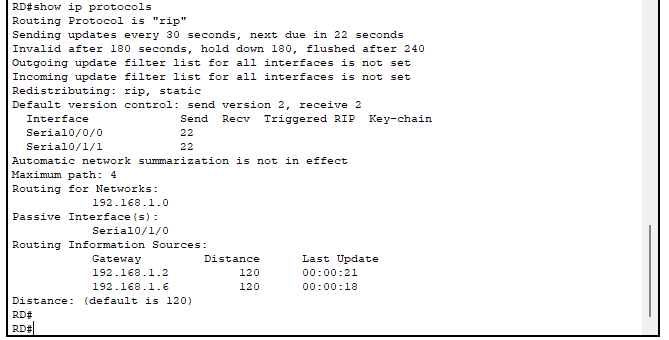

*Figura 9. `show ip protocols` en RD.*

## 11. TecnoNova: RIP con cuatro routers y PAT

TecnoNova tiene **cuatro routers** en forma de rombo: el borde (RA), un router por VLAN y un router de servidores. Los servidores quedan a **dos saltos** del borde y tienen **dos caminos** de igual costo. La ruta por defecto se propaga por RIP hasta el router más lejano:

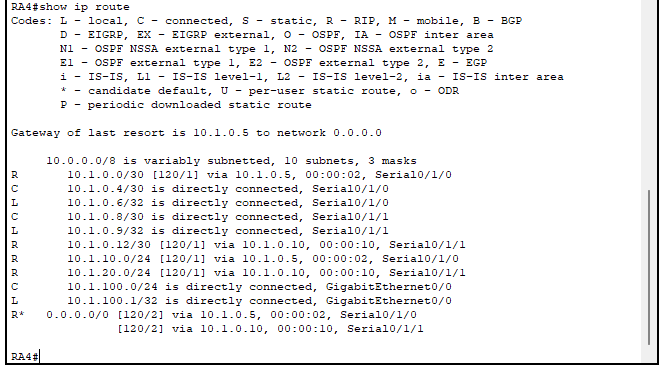

*Figura 10. `show ip route` en RA4: `R*` con dos caminos.*

El borde aplica **PAT** a las dos VLAN de usuarios y **NAT estático** a los dos servidores. Como el tráfico entra al borde por **dos seriales internas**, ambas llevan `ip nat inside`. Cuando dos hosts usan el mismo identificador, el router asigna otro (1024, 1025, 1026...) para distinguir las conexiones de la IP pública compartida (80.20.1.2).

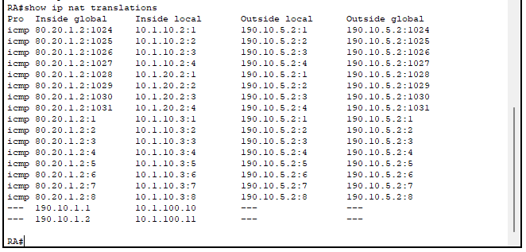

*Figura 11. `show ip nat translations` en RA.*

## 12. El mismo rango privado en dos empresas

ModaViva y GameZone usan **la misma red 192.168.10.0/24**, y la PC de cada una tiene la IP **192.168.10.2**. Ambas salen a internet sin conflicto, porque el ISP solo ve las direcciones traducidas:

| Empresa | Inside local | Inside global |
|---|---|---|
| ModaViva (pool con `overload`) | 192.168.10.2 | 190.10.2.3 |
| GameZone (PAT) | 192.168.10.2 | 80.20.2.6 |

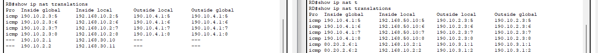

*Figura 12. `show ip nat translations` en RB (izquierda) y RD (derecha).*

Es la razón de ser de NAT: el rango privado se puede **repetir en miles de organizaciones** porque nunca viaja por internet.

## 13. Salida a internet

Para simular qué ocurre cuando un destino **no pertenece al ISP**, AN1 se conecta a un router (**UP**) con un servidor detrás (150.20.0.10).

- **Hacia afuera:** AN1 tiene una ruta por defecto hacia UP y la reparte por RIP. Todo lo que el ISP no conoce sale por ahí.
- **De regreso:** UP no conoce AndesNet, así que necesita rutas hacia las direcciones de este. Se resuelve con **tres rutas agregadas**, una por familia de direcciones, y ninguna hacia redes privadas:

```text
ip route 80.10.0.0 255.255.255.240 200.50.0.2   ! enlaces entre routers del ISP
ip route 80.20.0.0 255.255.252.0   200.50.0.2   ! enlaces con los clientes
ip route 190.10.0.0 255.255.248.0  200.50.0.2   ! bloques públicos de los clientes
```

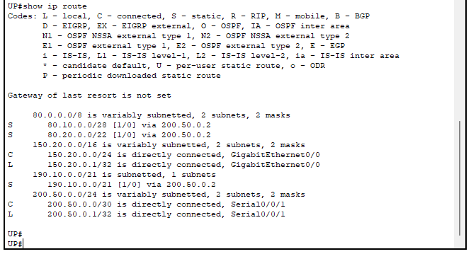

*Figura 13. `show ip route` en UP.*

Con eso, una PC de un cliente alcanza el servidor del "mundo" (el primer paquete se pierde por ARP):

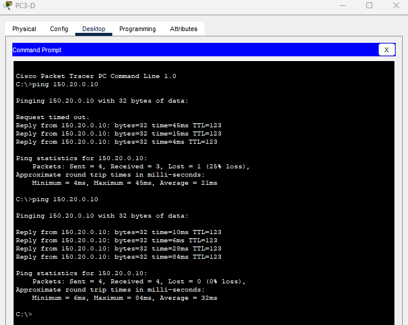

*Figura 14. PC3-D hace ping a 150.20.0.10.*

## 14. Las redes privadas no existen para internet

Desde el ISP no se puede alcanzar una IP privada de un cliente. Al ser AN1 un router con ruta por defecto, el paquete sale hacia UP, que no conoce redes privadas y contesta **destino inalcanzable** (la `U` del ping):

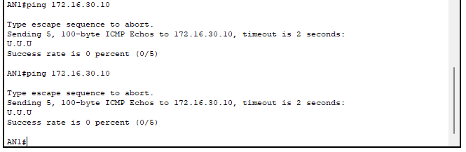

*Figura 15. AN1 hace ping a 172.16.30.10: 0% de éxito.*

Los servidores solo son accesibles por su **IP pública**, y esa traducción ocurre en el router de borde de la empresa.

## 15. Servicios web y tráfico TCP

Cada servidor aloja una página HTML con el nombre de la empresa y su IP pública, accesible por **HTTP y HTTPS**. Como no hay DNS en el laboratorio, se accede por IP. Desde EduNet se abre la página de Sabores del Sur:

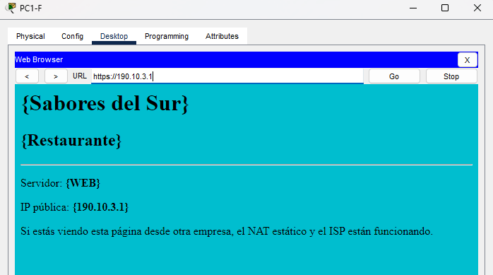

*Figura 16. PC1-F abre `https://190.10.3.1`.*

Esa misma conversación aparece en los **dos routers con los cuatro términos de NAT**:

| Router | Inside local | Inside global | Outside local | Outside global |
|---|---|---|---|---|
| **RF** (cliente) | 10.50.10.2:1025 | 80.20.3.6:1025 | 190.10.3.1:443 | 190.10.3.1:443 |
| **RC** (servidor) | 172.16.30.10:443 | 190.10.3.1:443 | 80.20.3.6:1025 | 80.20.3.6:1025 |

La IP **80.20.3.6** es la IP pública de EduNet y **190.10.3.1** es la del servidor de Sabores del Sur. El servidor nunca ve la IP privada del cliente, y el cliente nunca ve la privada del servidor.

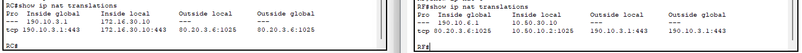

*Figura 17. `show ip nat translations` en RC (izquierda) y RF (derecha).*

## 16. Comandos de verificación

| Comando | Para qué sirve |
|---|---|
| `show ip nat translations` | Ver la tabla de traducción (una fila por conexión) |
| `show ip nat statistics` | Ver interfaces inside/outside, pool y contadores de *hits* y *misses* |
| `show ip route` | Ver rutas conectadas (`C`), estáticas (`S`) y aprendidas por RIP (`R`) |
| `show ip protocols` | Ver redes anunciadas por RIP e interfaces pasivas |
| `clear ip nat translation *` | Borrar las traducciones dinámicas |

## 17. Conclusiones

- **PAT es el tipo que ahorra direcciones:** una sola IP pública para toda una LAN. Lo que se agota son las **conexiones**, no los hosts.
- **El NAT dinámico puro no ahorra nada.** Cada host necesita su IP completa y el pool se agota con tres PC.
- **El NAT estático convive con los demás** y tiene prioridad: los servidores siempre se presentan con su IP pública fija, tanto al recibir como al iniciar conexiones.
- **El ISP no necesita conocer redes privadas.** Solo enruta direcciones públicas, mediante rutas estáticas hacia los bloques de sus clientes y RIP para repartirlas.
- **La frontera entre el mundo público y el privado** se marca en el router de borde: interfaces `inside` y `outside`, RIP pasivo hacia el ISP y una ruta por defecto hacia afuera.
- **Los protocolos de enrutamiento interno** (RIP) y NAT son independientes: RIP reparte rutas dentro de la empresa y NAT traduce en la frontera.
- **Un rango privado puede repetirse** en distintas empresas sin conflicto.
