# Laboratorio STP: PVST+ en una topología de tres capas

Laboratorio de Spanning Tree Protocol sobre una red conmutada de seis switches organizada en núcleo, distribución y acceso, con enlaces redundantes. Se observa cómo el protocolo elige el root bridge, asigna roles a los puertos, bloquea los enlaces que cerrarían un bucle, reconverge ante una falla y mantiene un árbol independiente por VLAN.

## Contenido

1. [Objetivo y alcance](#1-objetivo-y-alcance)
2. [Entorno](#2-entorno)
3. [Topología](#3-topología)
4. [Fundamentos aplicados](#4-fundamentos-aplicados)
5. [Comportamiento por defecto](#5-comportamiento-por-defecto)
6. [Diseño del root bridge](#6-diseño-del-root-bridge)
7. [Prueba de falla](#7-prueba-de-falla)
8. [Segunda VLAN: un árbol por VLAN](#8-segunda-vlan-un-árbol-por-vlan)
9. [Comparación entre VLAN 1 y VLAN 10](#9-comparación-entre-vlan-1-y-vlan-10)
10. [Conclusiones](#10-conclusiones)
11. [Limitaciones](#11-limitaciones)
12. [Estructura del repositorio y reproducción](#12-estructura-del-repositorio-y-reproducción)

---

## 1. Objetivo y alcance

El objetivo es entender y demostrar el funcionamiento de STP más allá de la teoría. Como el protocolo actúa por sí solo y casi no requiere configuración, el valor del laboratorio está en cuatro cosas:

- Observar qué decide el protocolo cuando no se interviene.
- Diseñar de forma intencional quién es el root bridge y quién es su respaldo.
- Predecir el resultado con el algoritmo antes de verificarlo en los equipos.
- Provocar una falla y comprobar que la redundancia funciona.

### Sobre PVST+

Los switches Cisco no ofrecen un modo 802.1D puro: su modo por defecto es **PVST+**, que ejecuta una instancia de STP por cada VLAN. Con una sola VLAN (la VLAN 1) se comporta como el STP clásico: un único árbol, los mismos temporizadores, el mismo método de costo corto y el mismo algoritmo. Además, en la VLAN 1 PVST+ interopera con el STP estándar IEEE 802.1D. La salida de `show spanning-tree` lo confirma con la línea `Spanning tree enabled protocol ieee`.

Por eso el laboratorio se desarrolla en dos etapas sobre la misma red física:

1. Solo con la VLAN 1, que equivale al STP clásico.
2. Con una segunda VLAN, donde aparece lo propio de PVST+: un árbol distinto por cada VLAN.

El algoritmo, las BPDU, los roles, los estados y los criterios de desempate son los del estándar IEEE. Lo específico de Cisco es el árbol por VLAN.

## 2. Entorno

| Elemento | Detalle |
|---|---|
| Emulador | GNS3 |
| Switches | Cisco IOU/IOL de capa 2 (6 unidades) |
| Router | Cisco c2691 (forma parte de la topología, sin participar en las pruebas) |
| Equipos finales | 4 VPCS (sin participar en las pruebas) |
| Modo de STP | PVST+ (por defecto en Cisco) |
| Costo por interfaz | 100 (las interfaces Ethernet de IOU cuentan como 10 Mbps) |

## 3. Topología

La red tiene dos switches de núcleo unidos por dos enlaces paralelos, dos de distribución conectados en malla completa con el núcleo, y dos de acceso, cada uno con dos subidas hacia la distribución. El router se conecta al SW-CORE1.

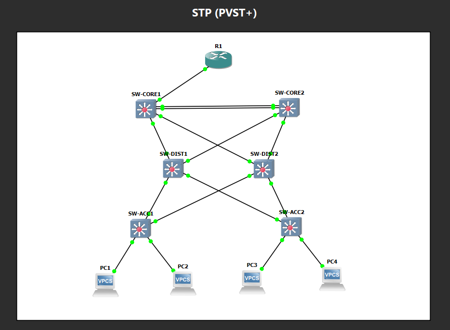

*Figura 01. Topología física en GNS3.*

### Tabla de cableado

| Enlace | Extremo A | Extremo B |
|---|---|---|
| 1 | SW-CORE1 Et0/0 | SW-CORE2 Et0/0 |
| 2 | SW-CORE1 Et0/1 | SW-CORE2 Et0/1 |
| 3 | SW-CORE1 Et0/2 | SW-DIST1 Et0/0 |
| 4 | SW-CORE1 Et0/3 | SW-DIST2 Et0/0 |
| 5 | SW-CORE2 Et0/2 | SW-DIST1 Et0/1 |
| 6 | SW-CORE2 Et0/3 | SW-DIST2 Et0/1 |
| 7 | SW-DIST1 Et0/2 | SW-ACC1 Et0/0 |
| 8 | SW-DIST1 Et0/3 | SW-ACC2 Et0/0 |
| 9 | SW-DIST2 Et0/2 | SW-ACC1 Et0/1 |
| 10 | SW-DIST2 Et0/3 | SW-ACC2 Et0/1 |
| 11 | SW-ACC1 Et0/2 y Et0/3 | PC1 y PC2 |
| 12 | SW-ACC2 Et0/2 y Et0/3 | PC3 y PC4 |
| 13 | SW-CORE1 Et1/0 | R1 Fa0/0 |

### Qué obliga a resolver cada parte del diseño

| Elemento | Qué desempate fuerza |
|---|---|
| Dos enlaces paralelos CORE1-CORE2 | Mismo costo y mismo vecino: decide el Port ID |
| Cada switch de acceso con dos subidas de igual costo | Decide el Bridge ID del vecino |
| Triángulos núcleo-distribución | Elección del puerto designado por Bridge ID |

Los diez enlaces entre switches deben repartirse así: cinco forman el árbol (root ports) y cinco quedan bloqueados en uno de sus extremos. Es un árbol de seis switches, que tiene N − 1 = 5 enlaces activos. Esta cuenta sirve de comprobación en cada etapa.

## 4. Fundamentos aplicados

### Algoritmo

STP toma tres decisiones en orden, y cada una depende de la anterior:

1. Elegir el **root bridge**.
2. Elegir el **root port** de cada switch que no es raíz.
3. Elegir el **designated port** de cada enlace. Los puertos restantes quedan bloqueados (non-designated).

### Criterios de desempate

En cualquier decisión se aplican, en este orden, y solo se pasa al siguiente si hay empate:

1. Root Bridge ID más bajo.
2. Costo de ruta más bajo hacia el root.
3. Bridge ID más bajo del switch que emite la BPDU.
4. Port ID más bajo del puerto que emite la BPDU.

### Bridge ID

El Bridge ID se compone de la prioridad del bridge, el número de VLAN (Extended System ID) y la dirección MAC. La prioridad se configura en múltiplos de 4096 y el valor mostrado es la suma con el número de VLAN. Por ejemplo, la prioridad por defecto aparece como 32769 en la VLAN 1 (32768 + 1).

### Estados y temporizadores

| Temporizador | Valor |
|---|---|
| Hello | 2 s |
| Max Age | 20 s |
| Forward Delay | 15 s |

Un puerto que pasa de bloqueado a reenvío recorre Listening (15 s) y Learning (15 s) antes de llegar a Forwarding.

## 5. Comportamiento por defecto

Con todos los switches en su configuración inicial, todos tienen prioridad 32769 en la VLAN 1. Al empatar, gana la **MAC más baja**. Las direcciones de los switches son `aabb.cc00.0100` (SW-ACC1), `0200` (SW-ACC2), `0300` (SW-DIST1), `0400` (SW-DIST2), `0500` (SW-CORE1) y `0600` (SW-CORE2).

### 5.1 SW-ACC1 resulta ser el root

El switch con la MAC más baja es SW-ACC1, un switch de acceso. La salida muestra "This bridge is the root" y todos sus puertos son designados en reenvío.

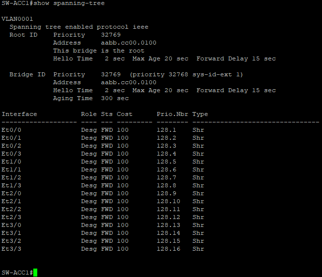

*Figura 03. SW-ACC1 como root bridge por defecto.*

### 5.2 Resto de los switches

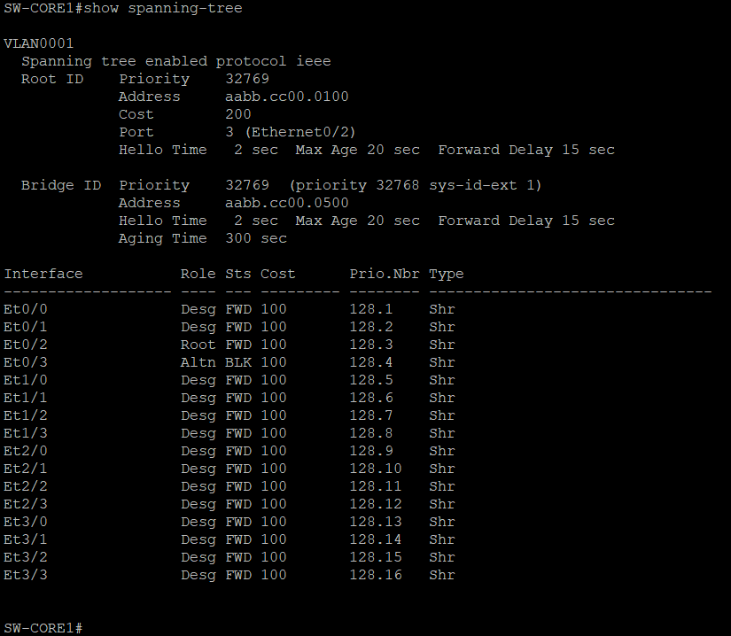

*Figura 02. SW-CORE1 por defecto: Et0/2 root hacia DIST1 y Et0/3 alterno (bloqueado) hacia DIST2.*

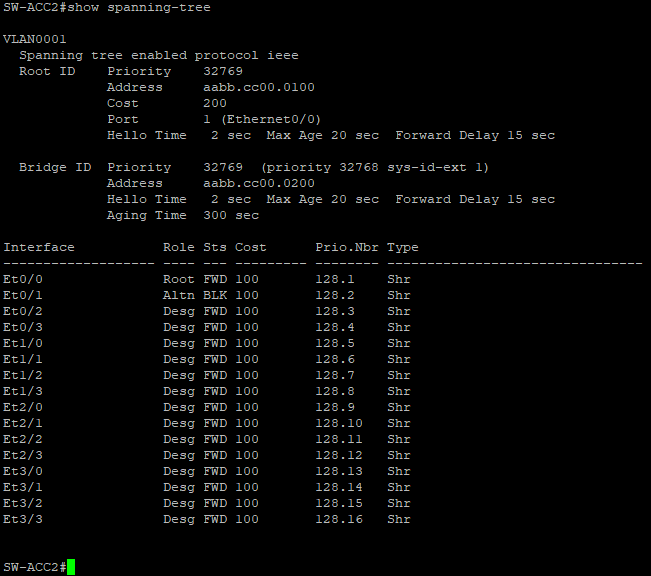

*Figura 04. SW-ACC2 por defecto: tiene dos subidas de igual costo y una queda bloqueada.*

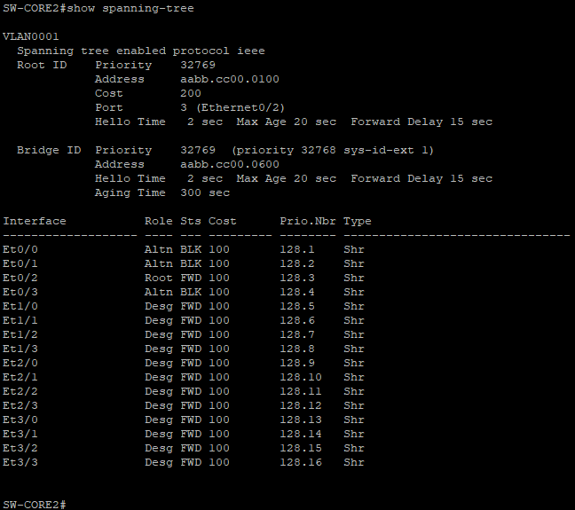

*Figura 05. SW-CORE2 por defecto: concentra tres puertos bloqueados.*

<details>
<summary>Ver captura de SW-DIST1 por defecto</summary>

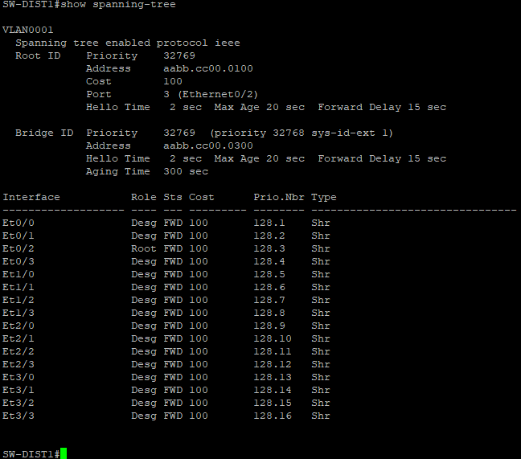

*Figura 06. SW-DIST1 por defecto: un root port hacia ACC1 y el resto de puertos designados.*

</details>

| Switch | Costo al root | Root port | Puertos bloqueados |
|---|---|---|---|
| SW-ACC1 | 0 (es el root) | no tiene | ninguno |
| SW-DIST1 | 100 | Et0/2 (hacia ACC1) | ninguno |
| SW-DIST2 | 100 | Et0/2 (hacia ACC1) | ninguno |
| SW-ACC2 | 200 | Et0/0 (hacia DIST1) | Et0/1 |
| SW-CORE1 | 200 | Et0/2 (hacia DIST1) | Et0/3 |
| SW-CORE2 | 200 | Et0/2 (hacia DIST1) | Et0/0, Et0/1 y Et0/3 |

La fila de SW-DIST2 se deduce del algoritmo y coincide con el diagrama; no se tomó su captura en este estado.

### 5.3 Árbol resultante

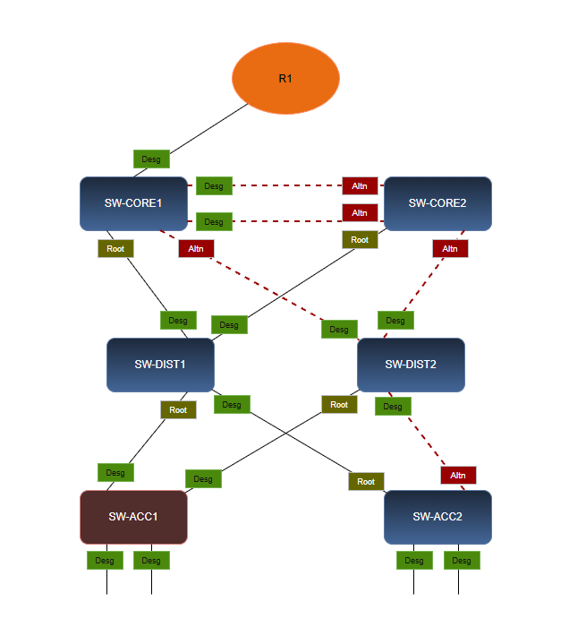

*Figura 07. Diagrama lógico del estado por defecto. Las líneas punteadas son los enlaces bloqueados.*

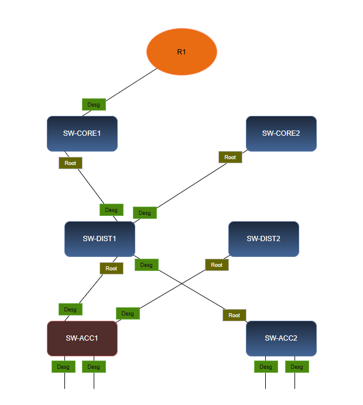

*Figura 08. Solo los enlaces activos del estado por defecto, sin los bloqueados.*

### 5.4 Análisis

- El root quedó en la **capa de acceso**, el peor lugar posible: el árbol se organiza alrededor de un switch periférico.
- Los **dos enlaces paralelos entre los switches de núcleo quedaron bloqueados** en SW-CORE2, así que SW-CORE2 solo se alcanza a través de SW-DIST1.
- Hay cinco puertos bloqueados, como exige la cuenta de control: SW-CORE1 Et0/3, SW-CORE2 Et0/0, Et0/1 y Et0/3, y SW-ACC2 Et0/1.
- Los switches con dos caminos de igual costo (CORE1, CORE2 y ACC2) eligieron SW-DIST1, porque su MAC (`...0300`) es menor que la de SW-DIST2 (`...0400`). Es el criterio 3 de desempate.

## 6. Diseño del root bridge

Para controlar el resultado se asigna la prioridad manualmente: SW-CORE1 como root y SW-CORE2 como respaldo. Los demás switches conservan la prioridad por defecto.

```
SW-CORE1# configure terminal
SW-CORE1(config)# spanning-tree vlan 1 priority 4096
SW-CORE1(config)# end
SW-CORE1# write memory

SW-CORE2# configure terminal
SW-CORE2(config)# spanning-tree vlan 1 priority 8192
SW-CORE2(config)# end
SW-CORE2# write memory
```

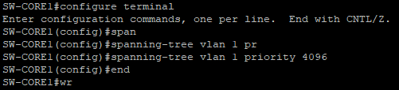

*Figura 09. Configuración de la prioridad 4096 en SW-CORE1.*

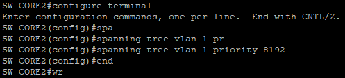

*Figura 10. Configuración de la prioridad 8192 en SW-CORE2.*

### 6.1 Resultado

SW-CORE1 pasa a ser el root con prioridad 4097 (4096 + VLAN 1) y todos sus puertos quedan designados.

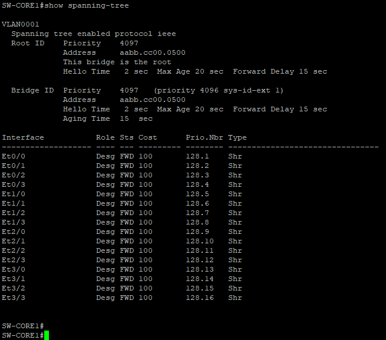

*Figura 11. SW-CORE1 como root bridge. El Aging Time aparece en 15 s, coherente con el aviso de cambio de topología que acorta el envejecimiento de la tabla MAC tras el cambio.*

En SW-CORE2 aparece el desempate por Port ID: sus dos enlaces hacia SW-CORE1 tienen el mismo costo y el mismo vecino, así que decide el Port ID del puerto que emite la BPDU. Gana Et0/0 (128.1) frente a Et0/1 (128.2).

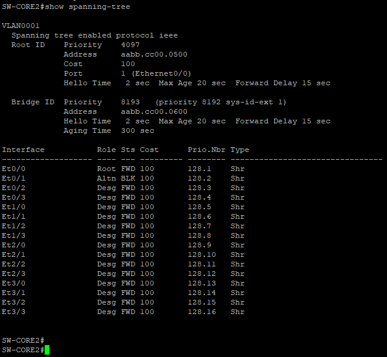

*Figura 12. SW-CORE2: root port en Et0/0 y alterno en Et0/1 por el criterio 4 (Port ID).*

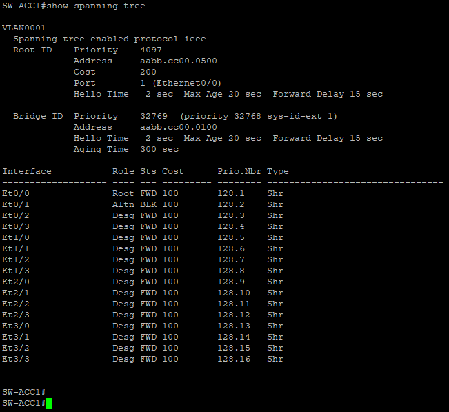

*Figura 13. SW-ACC1: sube por DIST1 (Et0/0) y bloquea la subida por DIST2 (Et0/1).*

<details>
<summary>Ver capturas de SW-DIST1, SW-DIST2 y SW-ACC2</summary>


*Figura 14. SW-DIST1: root port hacia CORE1 y el enlace hacia CORE2 bloqueado.*

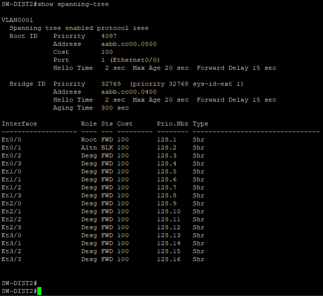

*Figura 15. SW-DIST2: root port hacia CORE1 y el enlace hacia CORE2 bloqueado.*

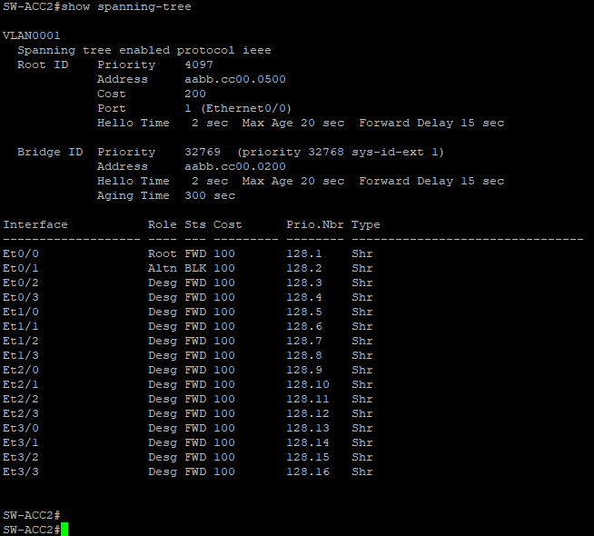

*Figura 16. SW-ACC2: sube por DIST1 y bloquea la subida por DIST2.*

</details>

| Switch | Costo al root | Root port | Puerto bloqueado |
|---|---|---|---|
| SW-CORE1 | 0 (es el root) | no tiene | ninguno |
| SW-CORE2 | 100 | Et0/0 | Et0/1 |
| SW-DIST1 | 100 | Et0/0 | Et0/1 |
| SW-DIST2 | 100 | Et0/0 | Et0/1 |
| SW-ACC1 | 200 | Et0/0 | Et0/1 |
| SW-ACC2 | 200 | Et0/0 | Et0/1 |

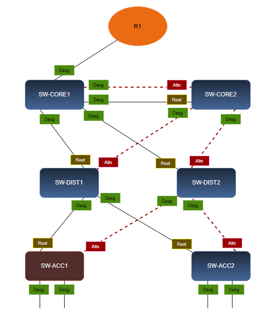

*Figura 17. Diagrama lógico con SW-CORE1 como root.*

### 6.2 Análisis

- Cinco puertos bloqueados, uno por cada switch no raíz. Que todos sean Et0/1 es consecuencia del cableado, no una regla del protocolo.
- En los enlaces entre SW-CORE2 y los switches de distribución, el costo de ambos extremos empata en 100 y decide el Bridge ID: SW-CORE2 (prioridad 8193) gana frente a la distribución (32769). Por eso el puerto bloqueado queda del lado de la distribución.
- Los switches de acceso eligen SW-DIST1 porque su Bridge ID es menor que el de SW-DIST2.
- Con un solo árbol, SW-CORE2 queda colgado de SW-CORE1 sin atender tráfico: la mitad de la redundancia está inactiva. Esto motiva la sección 8.

## 7. Prueba de falla

Para comprobar que la redundancia funciona se apagó el enlace entre SW-CORE1 y SW-DIST1, que era el camino activo de SW-DIST1 hacia el root. Se hizo desde SW-DIST1:

```
SW-DIST1# configure terminal
SW-DIST1(config)# interface ethernet0/0
SW-DIST1(config-if)# shutdown
```

### 7.1 Detección y transición de estados

SW-DIST1 detecta la caída de forma directa. Su puerto alterno hacia SW-CORE2, que estaba bloqueado, pasa a ser el nuevo root port y recorre los estados del protocolo. En la captura se ve en **Listening** (`LIS`). Se observa además que los puertos de bajada todavía figuran como designados en reenvío en ese instante.

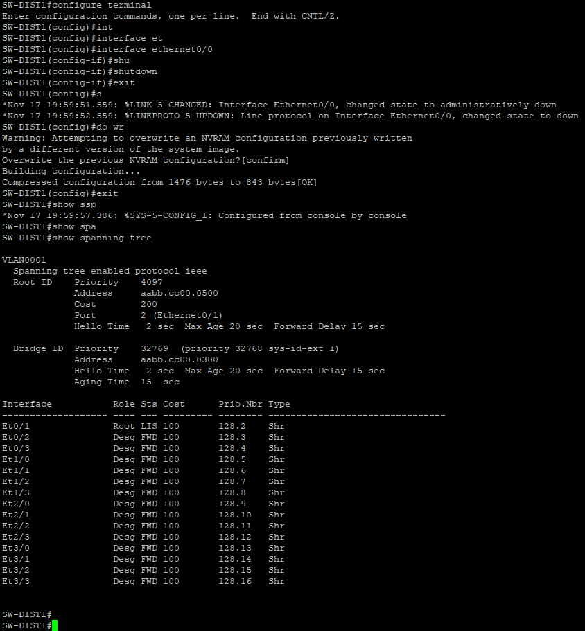

*Figura 18. Tras el `shutdown`, el nuevo root port de SW-DIST1 (Et0/1) está en Listening.*

### 7.2 Árbol reconvergido

Una vez estable, SW-DIST1 llega al root a costo 200 por SW-CORE2, y sus dos puertos de bajada quedan bloqueados.

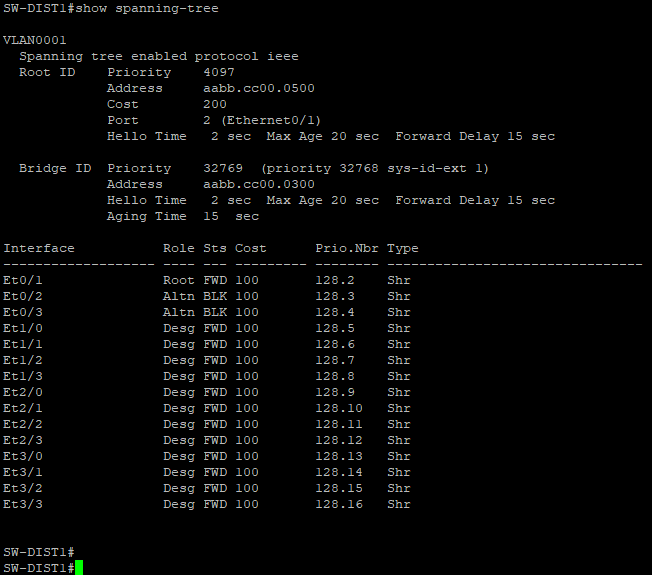

*Figura 19. SW-DIST1 tras la falla: root port en Et0/1 y Et0/2 y Et0/3 alternos.*

Los switches de acceso pierden su camino por SW-DIST1 y suben por SW-DIST2.

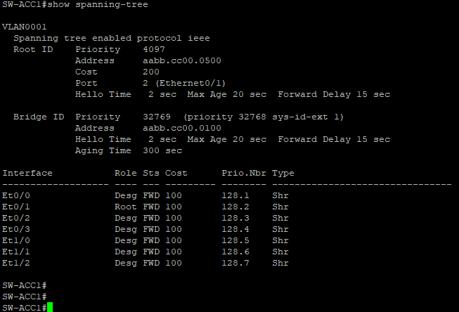

*Figura 20. SW-ACC1 durante la falla: su root port pasa a Et0/1 (hacia DIST2).*

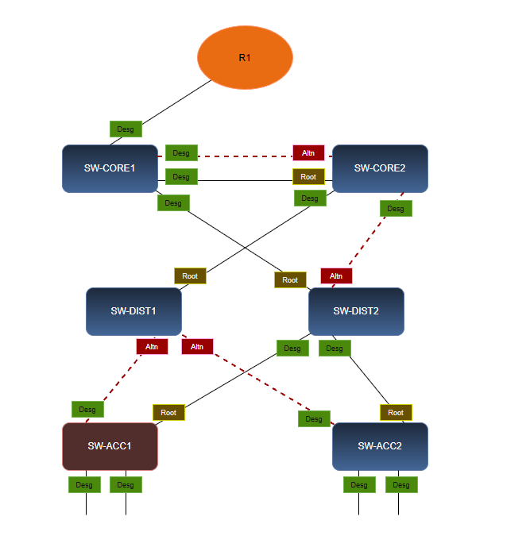

*Figura 21. Diagrama lógico con el enlace CORE1-DIST1 caído.*

### 7.3 Recuperación

Al reactivar la interfaz, los puertos que estaban bloqueados vuelven a pasar por **Learning**, y finalmente la topología regresa al estado anterior a la falla.

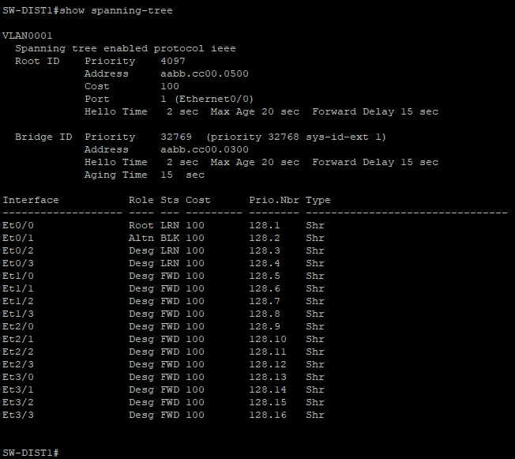

*Figura 22. Tras reactivar la interfaz, los puertos de SW-DIST1 pasan por Learning.*


*Figura 23. SW-DIST1 de nuevo con el mismo estado que antes de la falla (comparar con la Figura 14).*

### 7.4 Análisis

- La caída de **un solo enlace** reorganizó buena parte del árbol, no solo la vecindad del enlace. SW-DIST1 pasó de ser un switch central a una hoja colgada de SW-CORE2.
- Los puertos de bajada de SW-DIST1 quedaron bloqueados porque ahora está a costo 200, igual que los switches de acceso, y estos tienen un Bridge ID menor (MAC `...0100` y `...0200` frente a `...0300`).
- El estado final tiene 4 puertos bloqueados: 9 enlaces vivos menos los 5 del árbol.
- En condiciones de falla directa con un puerto alterno disponible, el tiempo teórico de recuperación es de 30 s (15 s en Listening y 15 s en Learning), sin esperar el Max Age.
- SW-CORE2 no cambia sus roles durante este escenario.

## 8. Segunda VLAN: un árbol por VLAN

Hasta aquí todo funcionó con la VLAN 1. PVST+ mantiene una instancia de STP por VLAN, lo que permite que cada una tenga un root distinto y use enlaces diferentes. Se crea la VLAN 10 y se asigna a SW-CORE2 como su root.

### 8.1 VLAN y troncales

Las BPDU de la VLAN 10 solo cruzan enlaces troncales. Por eso se crea la VLAN en los seis switches y se configuran como troncales los puertos que unen switches entre sí (en los switches de acceso, solo `ethernet0/0 - 1`).

```
SW-CORE1# configure terminal
SW-CORE1(config)# vlan 10
SW-CORE1(config-vlan)# name VLAN10
SW-CORE1(config-vlan)# exit
SW-CORE1(config)# interface range ethernet0/0 - 3
SW-CORE1(config-if-range)# switchport trunk encapsulation dot1q
SW-CORE1(config-if-range)# switchport mode trunk
SW-CORE1(config-if-range)# end
SW-CORE1# write memory
```

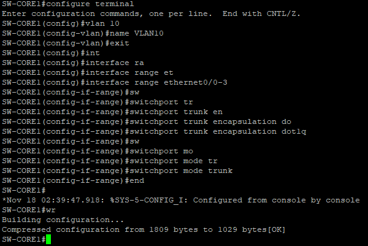

*Figura 24. Creación de la VLAN 10 y configuración de troncales en SW-CORE1. Se repite en los demás switches.*

### 8.2 Prioridades de la VLAN 10

Solo para la VLAN 10 se cambian estas prioridades. La de SW-DIST2 sirve para que los switches de acceso prefieran ese camino en esta VLAN.

| Switch | Prioridad en VLAN 10 | Comando |
|---|---|---|
| SW-CORE2 | 4096 (root) | `spanning-tree vlan 10 priority 4096` |
| SW-CORE1 | 8192 (respaldo) | `spanning-tree vlan 10 priority 8192` |
| SW-DIST2 | 16384 | `spanning-tree vlan 10 priority 16384` |
| SW-DIST1, SW-ACC1, SW-ACC2 | 32768 (por defecto) | sin cambios |

### 8.3 Resultado

SW-CORE2 es el root de la VLAN 10 (prioridad 4106 = 4096 + 10).

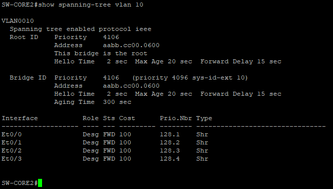

*Figura 25. SW-CORE2 como root bridge de la VLAN 10.*


*Figura 26. SW-DIST1 en la VLAN 10: root port hacia CORE2 (Et0/1) y el enlace hacia CORE1 bloqueado (Et0/0).*

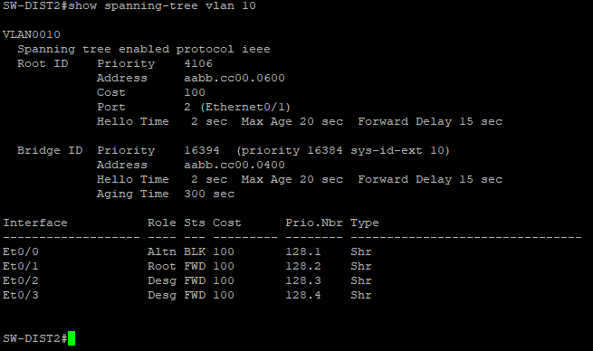

*Figura 27. SW-DIST2 en la VLAN 10, con prioridad 16394 (16384 + 10).*

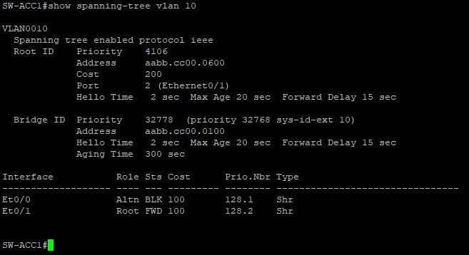

*Figura 28. SW-ACC1 en la VLAN 10: ahora sube por DIST2 (Et0/1) y bloquea la subida por DIST1 (Et0/0).*

<details>
<summary>Ver capturas de SW-CORE1 y SW-ACC2 en la VLAN 10</summary>

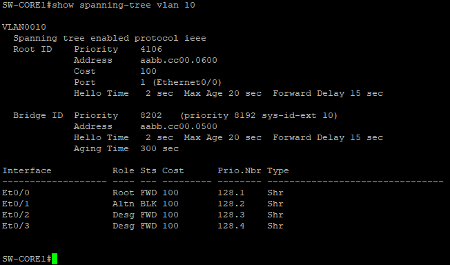

*Figura 29. SW-CORE1 en la VLAN 10 (prioridad 8202): root port en Et0/0 y alterno en Et0/1.*

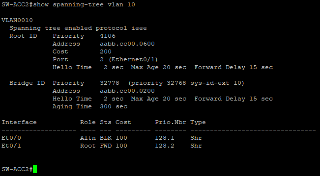

*Figura 30. SW-ACC2 en la VLAN 10: sube por DIST2.*

</details>

| Switch | Costo al root | Root port | Puerto bloqueado |
|---|---|---|---|
| SW-CORE2 | 0 (es el root) | no tiene | ninguno |
| SW-CORE1 | 100 | Et0/0 | Et0/1 |
| SW-DIST1 | 100 | Et0/1 | Et0/0 |
| SW-DIST2 | 100 | Et0/1 | Et0/0 |
| SW-ACC1 | 200 | Et0/1 | Et0/0 |
| SW-ACC2 | 200 | Et0/1 | Et0/0 |

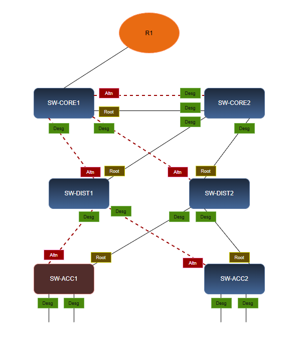

*Figura 31. Diagrama lógico de la VLAN 10.*

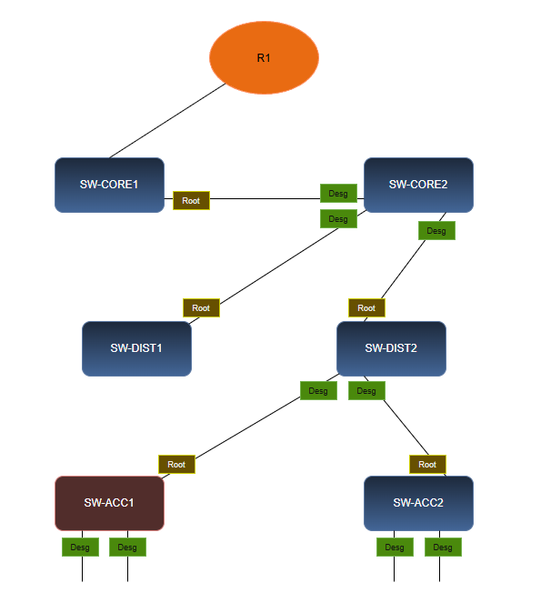

*Figura 32. Solo los enlaces activos de la VLAN 10.*

### 8.4 Análisis

- Con SW-CORE2 como root, el árbol se invierte en el núcleo: ahora los switches de distribución suben por SW-CORE2 y SW-CORE1 queda como hoja.
- Si se hubiera puesto a SW-CORE1 como root de la VLAN 10, el árbol habría salido igual que el de la VLAN 1 y no demostraría nada.
- Los switches de acceso prefieren SW-DIST2 en esta VLAN porque su Bridge ID (16394) es menor que el de SW-DIST1 (32778). La prioridad se evalúa antes que la MAC, y es el motivo por el que en la VLAN 1 preferían SW-DIST1.
- Se mantienen cinco puertos bloqueados: SW-CORE1 Et0/1, SW-DIST1 Et0/0, SW-DIST2 Et0/0, SW-ACC1 Et0/0 y SW-ACC2 Et0/0.

## 9. Comparación entre VLAN 1 y VLAN 10

La prueba central del laboratorio es que **un mismo puerto tiene estados opuestos según la VLAN**. En SW-DIST1, el puerto Et0/0 (hacia SW-CORE1) es root port y reenvía en la VLAN 1, pero está bloqueado en la VLAN 10.

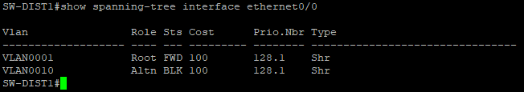

*Figura 33. `show spanning-tree interface ethernet0/0` en SW-DIST1: Root FWD en la VLAN 1 y Altn BLK en la VLAN 10.*

### Estado de cada enlace por VLAN

| Enlace | VLAN 1 (root CORE1) | VLAN 10 (root CORE2) |
|---|---|---|
| CORE1-CORE2, par de Et0/0 | Activo | Activo |
| CORE1-CORE2, par de Et0/1 | Bloqueado (extremo CORE2) | Bloqueado (extremo CORE1) |
| CORE1-DIST1 | Activo | Bloqueado (extremo DIST1) |
| CORE1-DIST2 | Activo | Bloqueado (extremo DIST2) |
| CORE2-DIST1 | Bloqueado (extremo DIST1) | Activo |
| CORE2-DIST2 | Bloqueado (extremo DIST2) | Activo |
| DIST1-ACC1 | Activo | Bloqueado (extremo ACC1) |
| DIST1-ACC2 | Activo | Bloqueado (extremo ACC2) |
| DIST2-ACC1 | Bloqueado (extremo ACC1) | Activo |
| DIST2-ACC2 | Bloqueado (extremo ACC2) | Activo |

- **8 de los 10 enlaces cambian de estado** entre una VLAN y la otra.
- Con un solo árbol (VLAN 1), solo **5 de los 10 enlaces** llevaban tráfico. Con las dos VLAN, **9 de 10** lo llevan; solo queda sin uso el segundo enlace paralelo entre los switches de núcleo.
- Ese reparto es el **balanceo de carga por VLAN** de PVST+, logrado tanto en la capa de núcleo-distribución como en la de distribución-acceso.

## 10. Conclusiones

- STP no necesita configuración para evitar bucles, pero **sin diseño el resultado es impredecible**: por defecto el root lo decide la MAC más baja y puede quedar en el acceso.
- Fijar la prioridad en el núcleo coloca el root donde conviene y vuelve el árbol predecible con el algoritmo.
- Los cuatro criterios de desempate (root ID, costo, Bridge ID del emisor y Port ID del emisor) se vieron funcionar en la red real, incluido el último en los enlaces paralelos.
- La caída de un enlace puede reorganizar gran parte del árbol, y la recuperación pasa por los estados Listening, Learning y Forwarding.
- Con una segunda VLAN, PVST+ ofrece árboles distintos sobre la misma red física y aprovecha enlaces que con un solo árbol quedarían inactivos.
- La cuenta de control (10 enlaces, 5 activos y 5 bloqueados) se cumplió en todos los estados del laboratorio.

## 11. Limitaciones

- **No se midió el tiempo de convergencia con ping continuo.** El equipo de pruebas se saturaba con los nodos encendidos y los paquetes se perdían incluso entre equipos del mismo switch. La evidencia de la reconvergencia son las capturas de los estados y el 30 s citado es el valor teórico.
- **En el estado por defecto no se capturó SW-DIST2**; sus roles se deducen del algoritmo y del diagrama.
- **En la prueba de falla se verificó con `show` en SW-DIST1 y SW-ACC1.** Las etiquetas del resto de los switches en el diagrama de la Figura 21 provienen del algoritmo.
- **El router y los equipos finales no participaron en las pruebas.** STP se demuestra sin enrutar entre VLAN.
- **PVST+ es una variante de Cisco.** La parte del árbol por VLAN es específica de ese fabricante; el resto de los conceptos pertenece al estándar IEEE.

## 12. Estructura del repositorio y reproducción

```
STP/
└── STP_(PVST+)/
    ├── README.md
    ├── Lab_PVST+.gns3project
    └── capturas/
        ├── 01-topologia-gns3.png
        └── ... (33 imágenes)
```

Para reproducir el laboratorio:

1. Importar `Lab_PVST+.gns3project` en GNS3 (menú File, Import portable project).
2. Disponer de las imágenes de los switches IOU/IOL de capa 2 y del router c2691 configuradas en GNS3.
3. Encender los switches y esperar a que STP converja (alrededor de 50 s).
4. Verificar con `show spanning-tree`, `show spanning-tree vlan 10` y `show spanning-tree interface ethernet0/0`.

Siguientes etapas previstas: el mismo escenario con **Rapid PVST+** y con **MST**, para comparar la convergencia entre versiones sobre la misma topología.
