# Laboratorio Syslog: registro centralizado de eventos de red

Laboratorio en GNS3 en el que tres routers Cisco, conectados en triángulo con RIPv2 y repartidos en dos sedes con VLANs más una red de servidor, envían sus logs por la red a un servidor Debian con rsyslog. Cada router queda registrado en su propio archivo, con hora sincronizada por NTP y filtrado por nivel de severidad.

> [!IMPORTANT]
> Antes de usar el laboratorio, lee la sección [9. Notas para reproducir el laboratorio](#9-notas-para-reproducir-el-laboratorio): hay que ajustar el dúplex de los enlaces de los switches porque el cambio no se conserva al guardar.

## Contenido

1. [Objetivo](#1-objetivo)
2. [Conceptos clave](#2-conceptos-clave)
3. [Topología](#3-topología)
4. [Plan de direccionamiento](#4-plan-de-direccionamiento)
5. [Conexiones físicas](#5-conexiones-físicas)
6. [Implementación](#6-implementación)
7. [Pruebas y resultados](#7-pruebas-y-resultados)
8. [Conclusiones](#8-conclusiones)
9. [Notas para reproducir el laboratorio](#9-notas-para-reproducir-el-laboratorio)
10. [Estructura del repositorio](#10-estructura-del-repositorio)

---

## 1. Objetivo

Implementar un servicio de registro centralizado (syslog) sobre una red multisede y comprobar que los eventos de los dispositivos llegan al servidor de forma ordenada, identificable y con la hora correcta.

Objetivos específicos:

- Configurar un servidor rsyslog que reciba mensajes por UDP 514 y guarde un archivo por dispositivo de origen.
- Configurar los tres routers para que envíen sus logs al servidor, identificándose siempre con la IP de su interfaz Loopback0.
- Sincronizar la hora de los routers con NTP y mostrar los logs en hora local.
- Verificar la recepción de mensajes y el filtrado por nivel de severidad.
- Integrar el servicio en una red con RIPv2, VLANs y router-on-a-stick.

## 2. Conceptos clave

**Por qué syslog.** Los routers y switches están diseñados para reenviar tráfico de forma rápida y eficiente, no para almacenar datos. Sus mensajes se guardan en un buffer en RAM que es limitado, circular y volátil: se sobrescribe cuando se llena y se pierde al reiniciar el equipo. Para auditorías, diagnóstico de fallos e incidentes de seguridad hace falta conservar un histórico, y eso se logra enviando los mensajes a un servidor con almacenamiento.

**Qué es syslog.** Es un protocolo de la capa de aplicación. El dispositivo (cliente) empaqueta cada mensaje y lo envía por la red, normalmente por **UDP 514**, a un servidor receptor. Es unidireccional: el servidor no confirma la recepción.

**Destinos de los mensajes en un router Cisco.**

| Destino | Comportamiento por defecto |
|---|---|
| Consola | Activo, haya o no una conexión física |
| Líneas VTY | Se activa en la sesión con `terminal monitor` |
| Buffer en RAM | Activo (se consulta con `show logging`) |
| Servidor syslog remoto | Hay que habilitarlo con `logging host` |

**Niveles de severidad.** Cuanto menor es el número, más crítico es el mensaje. El filtro de envío es acumulativo: configurar un nivel incluye ese número y todos los menores.

| Nivel | Nombre | Significado |
|---|---|---|
| 0 | Emergencies | Sistema inutilizable |
| 1 | Alerts | Se requiere acción inmediata |
| 2 | Critical | Condiciones críticas |
| 3 | Errors | Condiciones de error |
| 4 | Warnings | Condiciones de advertencia |
| 5 | Notifications | Eventos normales pero significativos |
| 6 | Informational | Mensajes informativos |
| 7 | Debugging | Mensajes de depuración |

**Formato de un mensaje Cisco:** `%FACILIDAD-SEVERIDAD-MNEMÓNICO: texto`. El número central indica el nivel; por ejemplo, `%LINK-3-UPDOWN` es de nivel 3 y `%SYS-5-CONFIG_I` es de nivel 5.

## 3. Topología

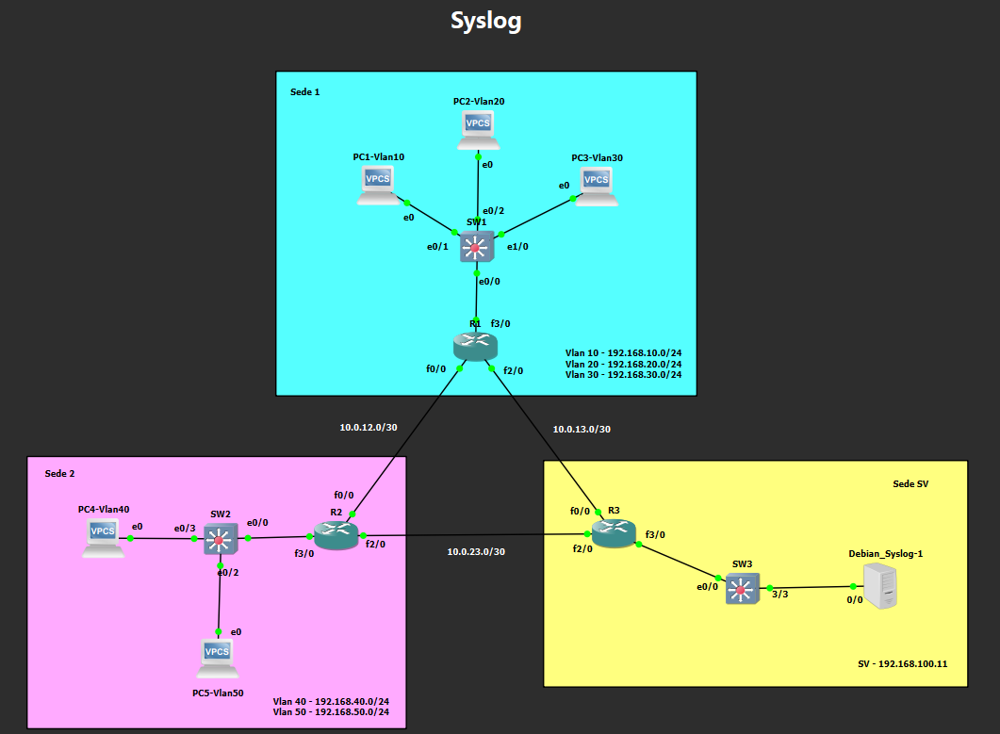

| Dispositivo | Tipo | Imagen o software | Rol |
|---|---|---|---|
| R1-SEDE1 | Router Cisco 7200 | `c7200-advipservicesk9-mz.152-4.S5` | Sede 1 (VLANs 10, 20 y 30) |
| R2-SEDE2 | Router Cisco 7200 | `c7200-advipservicesk9-mz.152-4.S5` | Sede 2 (VLANs 40 y 50) |
| R3-SV | Router Cisco 7200 | `c7200-advipservicesk9-mz.152-4.S5` | Red del servidor |
| SW1, SW2, SW3 | Switch IOU L2 | `i86bi-linux-l2-ipbasek9-15.1g` | Acceso de cada sede y del servidor |
| PC1 a PC5 | VPCS | Incluido en GNS3 | Una PC por VLAN |
| Debian_Syslog | VM en VirtualBox | Debian con rsyslog 8.2504.0 | Servidor syslog |

Las imágenes de IOS no se incluyen en este repositorio por tratarse de software con licencia.

## 4. Plan de direccionamiento

**Redes de usuarios**

| Sede | VLAN | Nombre | Red | Gateway |
|---|---|---|---|---|
| 1 (R1) | 10 | Ventas | 192.168.10.0/24 | 192.168.10.1 |
| 1 (R1) | 20 | Administración | 192.168.20.0/24 | 192.168.20.1 |
| 1 (R1) | 30 | Soporte | 192.168.30.0/24 | 192.168.30.1 |
| 2 (R2) | 40 | Ingeniería | 192.168.40.0/24 | 192.168.40.1 |
| 2 (R2) | 50 | Invitados | 192.168.50.0/24 | 192.168.50.1 |

**Enlaces entre routers**

| Enlace | Red | Direcciones |
|---|---|---|
| R1 – R2 | 10.0.12.0/30 | R1 `.1`, R2 `.2` |
| R1 – R3 | 10.0.13.0/30 | R1 `.1`, R3 `.2` |
| R2 – R3 | 10.0.23.0/30 | R2 `.1`, R3 `.2` |

**Loopbacks y servidor**

| Elemento | Dirección |
|---|---|
| Loopback0 de R1 | 10.255.0.1/32 |
| Loopback0 de R2 | 10.255.0.2/32 |
| Loopback0 de R3 | 10.255.0.3/32 |
| Red del servidor | 192.168.100.0/24 |
| Gateway (R3) | 192.168.100.1 |
| Servidor Debian_Syslog | 192.168.100.11 |

## 5. Conexiones físicas

| Extremo A | Extremo B | Función |
|---|---|---|
| R1 `Fa0/0` | R2 `Fa0/0` | Enlace 10.0.12.0/30 |
| R1 `Fa2/0` | R3 `Fa0/0` | Enlace 10.0.13.0/30 |
| R2 `Fa2/0` | R3 `Fa2/0` | Enlace 10.0.23.0/30 |
| R1 `Fa3/0` | SW1 `Et0/0` | Troncal de la sede 1 |
| R2 `Fa3/0` | SW2 `Et0/0` | Troncal de la sede 2 |
| R3 `Fa3/0` | SW3 `Et0/0` | Red del servidor |
| SW1 `Et0/1`, `Et0/2`, `Et1/0` | PC1, PC2, PC3 | VLAN 10, 20 y 30 |
| SW2 `Et0/3`, `Et0/2` | PC4, PC5 | VLAN 40 y 50 |
| SW3 `Et3/3` | Debian_Syslog | Servidor syslog |

## 6. Implementación

### 6.1 Servidor syslog (rsyslog)

En Debian no siempre viene instalado rsyslog, que es el servicio capaz de recibir mensajes por red (journald solo registra de forma local).

```bash
sudo apt update
sudo apt install rsyslog
```

Para que escuche en UDP 514 se habilitan estas dos líneas en `/etc/rsyslog.conf`:

```
module(load="imudp")
input(type="imudp" port="514")
```

Para guardar un archivo por dispositivo se crea `/etc/rsyslog.d/10-remoto.conf`:

```
template(name="LogsRemotos" type="string" string="/var/log/remoto/%fromhost-ip%.log")

if ($fromhost-ip != "127.0.0.1") then {
    action(type="omfile" dynaFile="LogsRemotos")
    stop
}
```

- La plantilla usa la IP de origen del mensaje como nombre de archivo.
- El filtro solo actúa sobre mensajes que no vienen de la propia máquina.
- `stop` evita que el mensaje remoto se duplique en `/var/log/syslog`.

Una copia de este archivo está en [`configs/10-remoto.txt`](configs/10-remoto.txt).

La sintaxis se valida con `/usr/sbin/rsyslogd -N1` antes de reiniciar el servicio con `sudo systemctl restart rsyslog`.

**Servicio activo y escuchando en el puerto 514:**

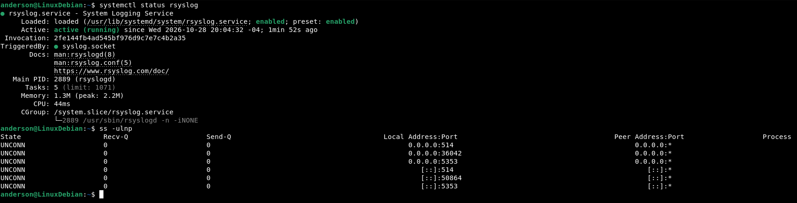

**Configuración aplicada:**

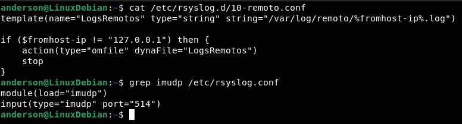

**Red del servidor (IP fija y gateway hacia R3):**

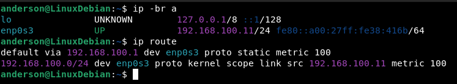

### 6.2 Interfaces y loopbacks

Cada enlace entre routers es una red /30. La Loopback0 es una interfaz virtual que nunca se cae mientras el router esté encendido, por lo que sirve como identidad estable del router ante el servidor syslog. Ejemplo en R1:

```
hostname R1-SEDE1
interface FastEthernet0/0
 description Enlace a R2
 ip address 10.0.12.1 255.255.255.252
 no shutdown
interface FastEthernet2/0
 description Enlace a R3
 ip address 10.0.13.1 255.255.255.252
 no shutdown
interface Loopback0
 ip address 10.255.0.1 255.255.255.255
```

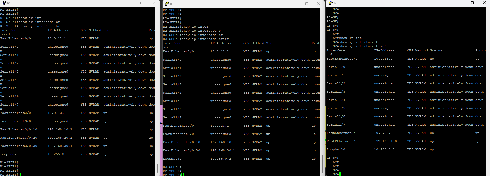

### 6.3 Enrutamiento con RIPv2

Se configuró RIP versión 2 en los tres routers. Ejemplo en R1:

```
router rip
 version 2
 no auto-summary
 network 10.0.0.0
 network 192.168.10.0
 network 192.168.20.0
 network 192.168.30.0
 passive-interface Loopback0
 passive-interface FastEthernet3/0.10
 passive-interface FastEthernet3/0.20
 passive-interface FastEthernet3/0.30
```

- `version 2` envía la máscara en las actualizaciones, necesario para manejar redes /30 y /32.
- `no auto-summary` evita que las redes `192.168.x.0` se resuman a nivel de clase.
- `passive-interface` anuncia la red sin enviar actualizaciones hacia los usuarios.

R2 anuncia las redes 192.168.40.0 y 192.168.50.0, y R3 anuncia 192.168.100.0.

En la tabla de R3 se ven las rutas de las dos sedes y las loopbacks. Además, para la red 10.0.12.0/30 (el enlace entre R1 y R2) R3 tiene dos caminos de igual costo, uno por cada router, lo que refleja la redundancia del triángulo.

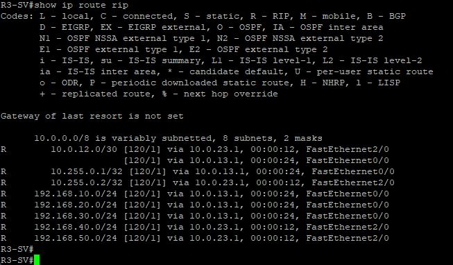

### 6.4 VLANs y router-on-a-stick

En cada switch se crean las VLANs, el puerto hacia el router se configura como troncal 802.1Q y los puertos de las PCs como acceso. Ejemplo en SW1:

```
vlan 10
 name Ventas
vlan 20
 name Administracion
vlan 30
 name Soporte
interface Ethernet0/0
 description Troncal a R1
 switchport trunk encapsulation dot1q
 switchport mode trunk
interface Ethernet0/1
 switchport mode access
 switchport access vlan 10
interface Ethernet0/2
 switchport mode access
 switchport access vlan 20
interface Ethernet1/0
 switchport mode access
 switchport access vlan 30
```

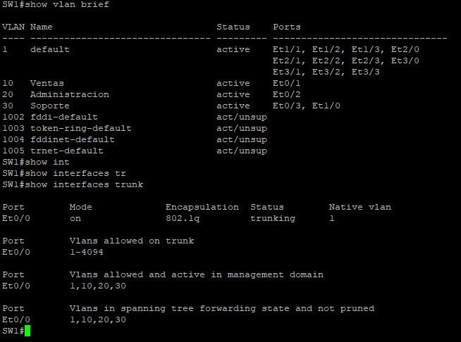

En el router, la interfaz física no lleva IP y cada VLAN se atiende con una subinterfaz que hace de gateway. Ejemplo en R1:

```
interface FastEthernet3/0
 no shutdown
interface FastEthernet3/0.10
 encapsulation dot1Q 10
 ip address 192.168.10.1 255.255.255.0
interface FastEthernet3/0.20
 encapsulation dot1Q 20
 ip address 192.168.20.1 255.255.255.0
interface FastEthernet3/0.30
 encapsulation dot1Q 30
 ip address 192.168.30.1 255.255.255.0
```

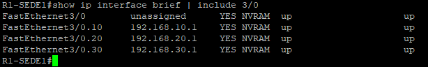

### 6.5 Verificación de conectividad

Antes de configurar syslog se comprobó que las PCs se comunican entre sedes y que ambas sedes llegan al servidor.

**Entre sedes (PC2 de la VLAN 20 hacia un equipo de la VLAN 40):**

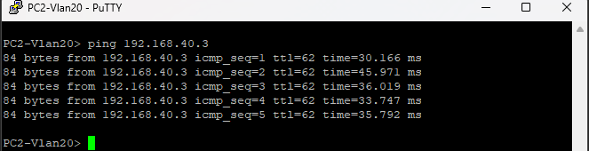

**Hacia el servidor (desde las dos sedes):**

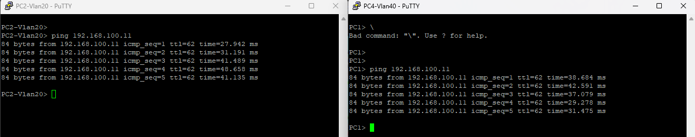

### 6.6 Syslog en los routers

Configuración aplicada en R1, R2 y R3:

```
clock timezone VET -4
service timestamps log datetime msec localtime show-timezone
no logging console
logging source-interface Loopback0
logging host 192.168.100.11
logging trap notifications
end
write memory
```

| Comando | Función |
|---|---|
| `clock timezone VET -4` | Define la zona horaria para mostrar la hora local |
| `service timestamps log datetime msec localtime show-timezone` | Añade fecha, hora local con milisegundos y zona a cada mensaje |
| `no logging console` | Quita el envío a la consola y ahorra CPU |
| `logging source-interface Loopback0` | El router se identifica siempre con la IP de su loopback, sin importar por qué enlace salga |
| `logging host 192.168.100.11` | Destino remoto: el servidor syslog (UDP 514) |
| `logging trap notifications` | Envía los niveles 0 a 5, que incluyen cambios de configuración y de estado de línea |

Se eligió el nivel 5 porque cubre los eventos de auditoría (por ejemplo, `%SYS-5-CONFIG_I`, que indica que alguien entró a configurar el equipo) sin el volumen de los niveles 6 y 7.

**Configuración presente en los tres routers:**

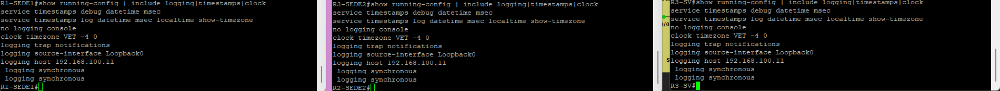

**Estado del servicio en R1.** Se ve la consola deshabilitada, el buffer en RAM, el destino remoto 192.168.100.11 por UDP 514, el nivel `notifications` y la Loopback0 como interfaz de origen:

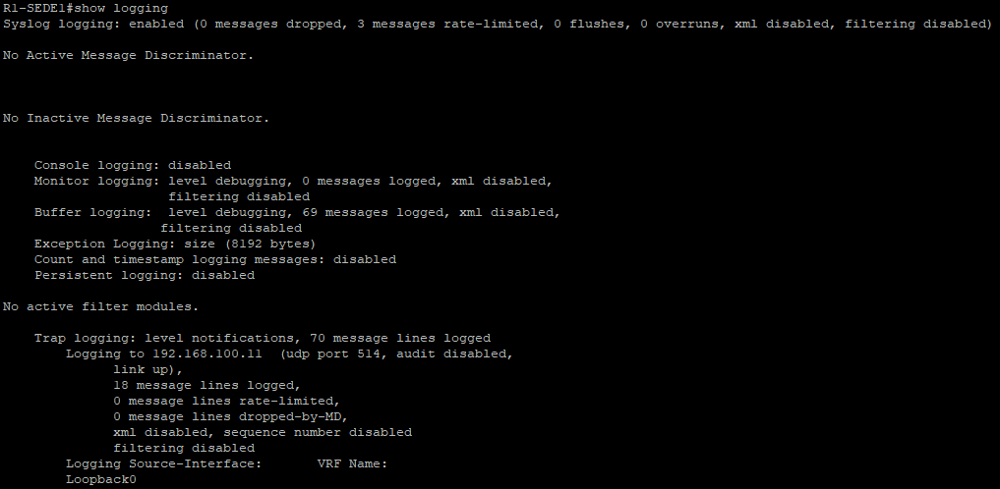

### 6.7 NTP

Para que los logs de distintos equipos se puedan ordenar y correlacionar, los tres routers comparten la misma hora. R3 actúa como fuente de hora del laboratorio y R1 y R2 se sincronizan con él a través de su loopback.

En R3:

```
ntp master 3
```

En R1 y R2:

```
ntp server 10.255.0.3
```

R3 queda en stratum 3 usando su reloj interno (`127.127.1.1`) y R1 y R2 en stratum 4, con referencia `10.255.0.3`. Mientras la hora no está sincronizada, el router antepone un asterisco a la hora de sus mensajes; al sincronizarse desaparece.

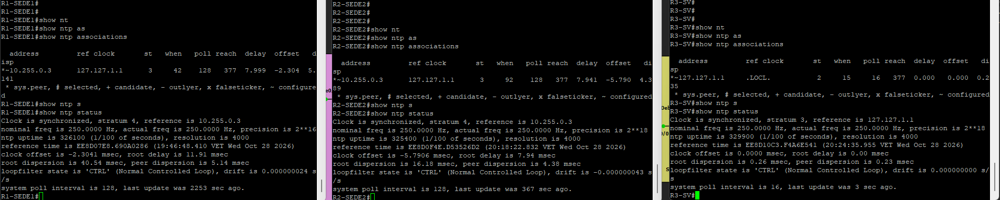

## 7. Pruebas y resultados

### 7.1 Primer log recibido

Con `tail -f` sobre el archivo de R1 en el servidor, cada vez que se entra y se sale del modo de configuración llega un mensaje `%SYS-5-CONFIG_I`. La hora del router aparece en hora local (`VET`) y sin asterisco, ya sincronizada.

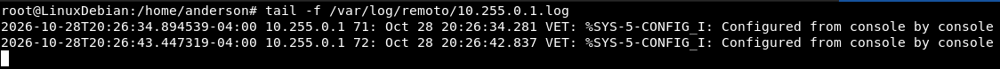

### 7.2 Un archivo por router

El servidor guarda los mensajes de cada router en un archivo con el nombre de su loopback, gracias a `logging source-interface Loopback0` y a la plantilla de rsyslog.

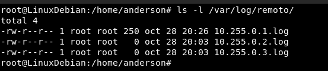

### 7.3 Filtrado por nivel de severidad

En R1 se ajustó `logging trap 4` y se creó una interfaz de prueba (`Loopback99`) que se apagó y volvió a encender. Con el filtro en nivel 4 solo llegó al servidor el mensaje de nivel 3 (`%LINK-3-UPDOWN`). Después se restauró `logging trap notifications` (nivel 5) y el servidor volvió a recibir `%SYS-5-CONFIG_I`.

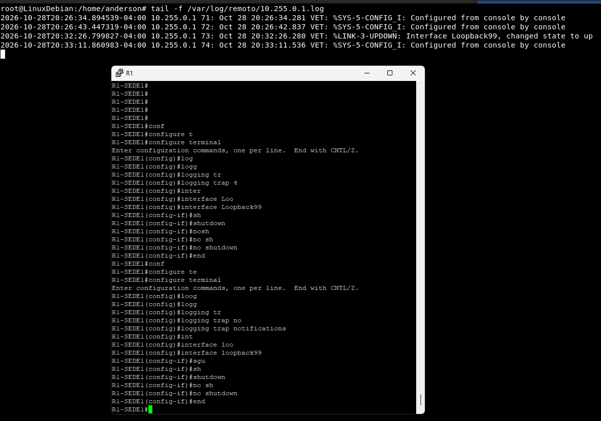

### 7.4 Evento de interfaz en R2

En R2 se apagó y se volvió a encender `FastEthernet0/0`, la interfaz del enlace hacia R1. El servidor registró toda la secuencia:

| Acción | Mensaje recibido | Nivel |
|---|---|---|
| `shutdown` | `%LINK-5-CHANGED ... administratively down` | 5 |
| `shutdown` | `%LINEPROTO-5-UPDOWN ... changed state to down` | 5 |
| Salir de configuración | `%SYS-5-CONFIG_I` | 5 |
| `no shutdown` | `%LINK-3-UPDOWN ... changed state to up` | 3 |
| `no shutdown` | `%LINEPROTO-5-UPDOWN ... changed state to up` | 5 |
| Salir de configuración | `%SYS-5-CONFIG_I` | 5 |

Los números de secuencia son consecutivos (del 58 al 64), por lo que no se perdió ningún mensaje en esta prueba. Esto importa porque syslog usa UDP y el servidor no confirma la recepción.

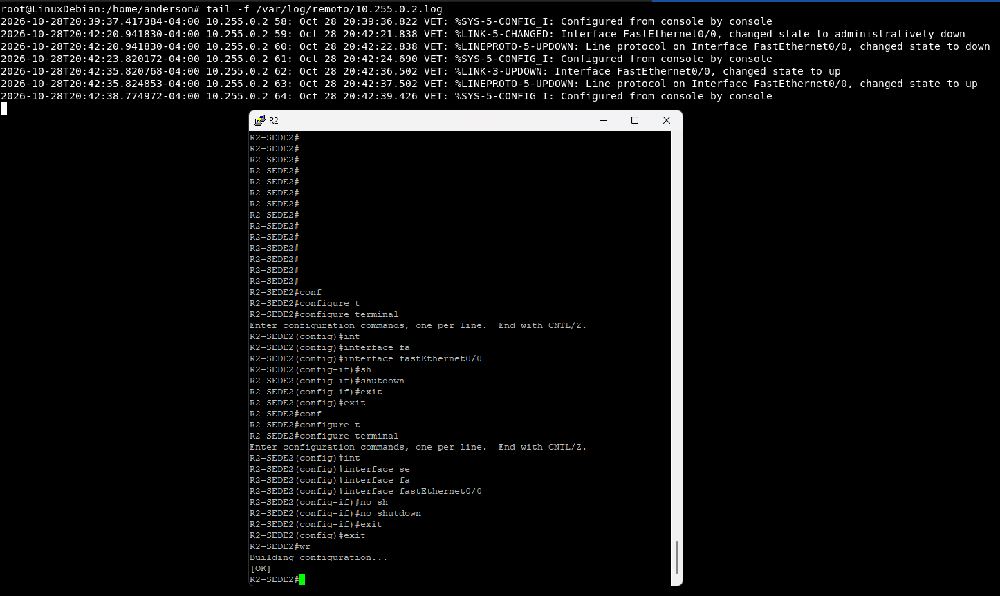

### 7.5 Anatomía de un mensaje

```
2026-10-28T20:42:20.941830-04:00 10.255.0.2 59: Oct 28 20:42:21.838 VET: %LINK-5-CHANGED: Interface FastEthernet0/0, changed state to administratively down
```

| Campo | Valor | Significado |
|---|---|---|
| Hora de recepción | `2026-10-28T20:42:20.941830-04:00` | Cuándo el servidor recibió el mensaje |
| Origen | `10.255.0.2` | Loopback0 de R2 |
| Secuencia | `59` | Número de mensaje del router; permite detectar pérdidas |
| Hora del router | `Oct 28 20:42:21.838 VET` | Hora local con milisegundos |
| Facilidad | `LINK` | Subsistema que genera el mensaje |
| Severidad | `5` | Nivel notifications |
| Mnemónico | `CHANGED` | Tipo de evento |
| Texto | `Interface FastEthernet0/0, ...` | Descripción del evento |

## 8. Conclusiones

- Centralizar los logs resuelve las limitaciones del buffer en RAM: el servidor conserva el histórico y no se pierde al reiniciar el router.
- Usar `Loopback0` como origen identifica a cada router con una IP estable. Si no se configura, el router usa la IP de la interfaz de salida y un mismo equipo puede acabar repartido en varios archivos.
- El nivel `notifications` equilibra utilidad y volumen: registra cambios de configuración y de estado de enlaces sin saturar al servidor ni a la red.
- NTP es necesario para que los logs de varios equipos sean comparables en el tiempo.
- UDP no confirma la entrega, así que los números de secuencia son la forma de detectar mensajes perdidos. En un entorno de producción conviene considerar transporte confiable y cifrado (TCP o TLS) y una red de gestión separada.
- El orden de los comandos importa: aplicar `logging source-interface` antes de `logging host`. Si el host se configura primero, el mensaje de inicio del envío sale con la IP de la interfaz de salida y crea un archivo extra en el servidor.

## 9. Notas para reproducir el laboratorio

**Dúplex de los switches.** En la interfaz `Ethernet0/0` de cada switch, la que conecta con su router, hay que configurar el dúplex manualmente. Aunque se guarde la configuración, el valor no se conserva, así que debe aplicarse de nuevo cada vez que se abre el laboratorio:

```
interface Ethernet0/0
 duplex full
```

Se puede comprobar con `show interfaces Ethernet0/0`.

**Servidor.** La VM debe tener un único adaptador de red habilitado y encenderse solo desde GNS3. Con dos adaptadores, el cable de GNS3 quedó asociado a una interfaz distinta de la que tenía la IP del laboratorio.

**Imágenes.** Hacen falta una imagen de router Cisco 7200 y una imagen de switch IOU L2, indicadas en la sección 3. No se distribuyen aquí.

**Guardado.** Tras configurar, ejecutar `write memory` en routers y switches, `save` en cada VPCS y guardar el proyecto de GNS3.

## 10. Estructura del repositorio

```
syslog/
├── README.md
├── capturas/
│   ├── 01-topologia_general.png
│   ├── 02-servidor_rsyslog_activo.png
│   ├── 03-servidor_config_rsyslog.png
│   ├── 04-servidor_red.png
│   ├── 05-routers_interfaces_ip.png
│   ├── 06-rip_rutas_aprendidas.png
│   ├── 07-switch_vlans_troncal.png
│   ├── 08-router_subinterfaces.png
│   ├── 09-prueba_ping_entre_sedes.png
│   ├── 10-prueba_ping_al_servidor.png
│   ├── 11-config_syslog_routers.png
│   ├── 12-show_logging_r1.png
│   ├── 13-ntp_sincronizacion.png
│   ├── 14-prueba_primer_log.png
│   ├── 15-prueba_archivo_por_router.png
│   ├── 16_prueba_nivel_trap4_trap_5.png
│   └── 17-router2_interfaz_apagada_encendida.png
└── configs/
    ├── R1-SEDE1.txt
    ├── R2-SEDE2.txt
    ├── R3-SV.txt
    ├── SW1.txt
    ├── SW2.txt
    ├── SW3.txt
    ├── PCs.txt
    └── 10-remoto.txt
```

La carpeta `configs/` reúne la configuración de cada equipo en texto plano (salida de `show running-config` de los routers y switches, y de `show ip` de las PCs) y una copia del archivo de rsyslog del servidor (`10-remoto.txt`, que en el servidor es `/etc/rsyslog.d/10-remoto.conf`).

**Sobre el archivo de proyecto de GNS3.** No se incluye en este repositorio. Aun así, la topología (sección 3), el direccionamiento (sección 4), las conexiones (sección 5), las configuraciones y comandos (sección 6 y carpeta `configs/`) y las capturas de resultados (secciones 6 y 7) documentan el laboratorio completo y permiten reconstruirlo en GNS3, además de dejar constancia del trabajo realizado.
