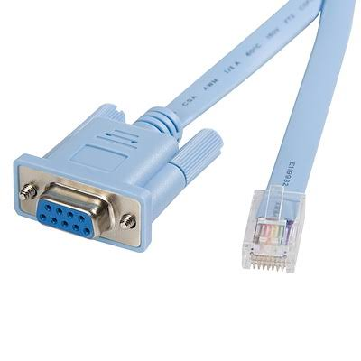
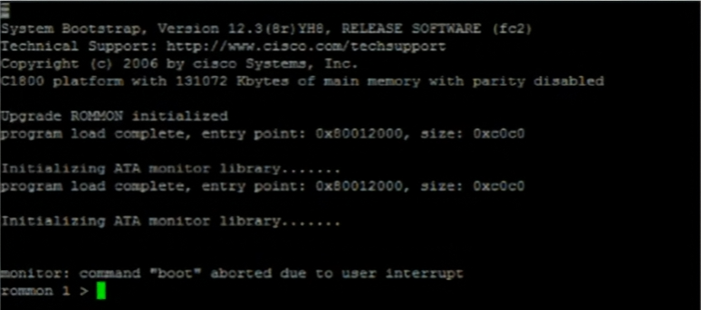
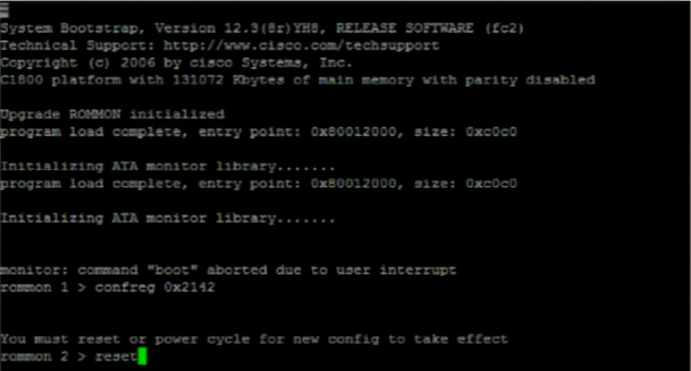
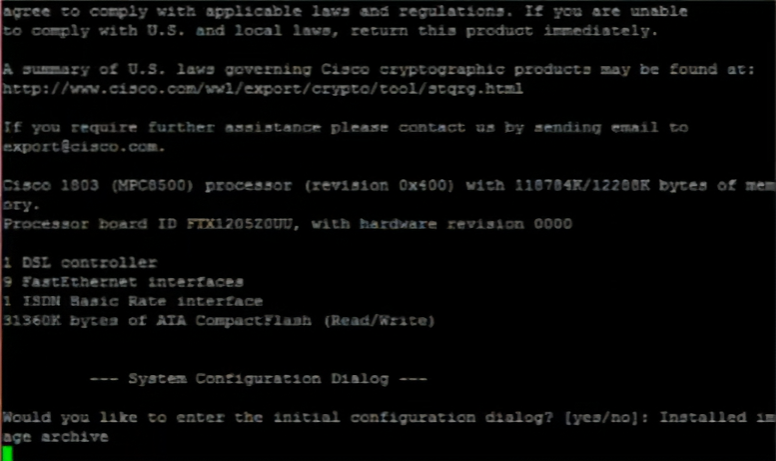
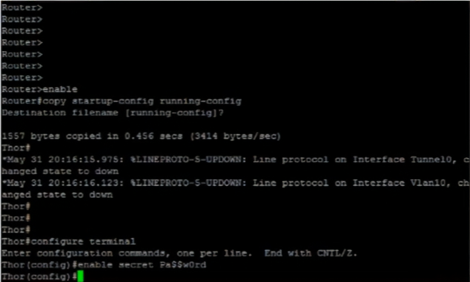
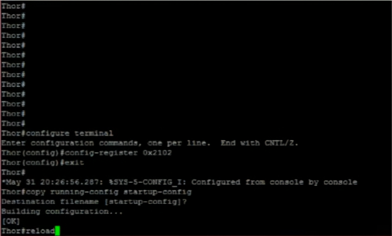

# Recuperación de contraseñas en dispositivos Cisco

> Procedimiento para recuperar el acceso a un router Cisco cuando se perdió la contraseña, **sin perder la configuración existente** (IPs, ACLs, rutas y protocolos).

---

## Descripción

Cuando se pierde la contraseña de un equipo Cisco no es posible "leerla": las claves protegidas con `enable secret` se guardan cifradas con hash. Lo que se hace en realidad es **cambiarla**.

La idea central del procedimiento es lograr que el router arranque **ignorando la startup-config** guardada en la NVRAM, aunque esta siga intacta. Así se entra al equipo sin clave, se trae la configuración vieja a la RAM, se sobrescribe la contraseña y se deja todo guardado.

## Objetivos

- Identificar los cables y puertos de consola de los equipos Cisco.
- Comprender el proceso de arranque de un router y el papel de cada memoria.
- Entender qué es el ROMMON y el registro de configuración (`config-register`).
- Aplicar el procedimiento completo de cambio de contraseña sin perder la configuración.
- Reconocer los errores típicos y cómo evitarlos.

---

## 1. Acceso por consola

El procedimiento exige **acceso físico** al equipo, conectándose por el puerto de consola. No se puede hacer por SSH ni Telnet, porque estos dependen de que el IOS ya esté funcionando y de conocer la clave.

| Cable | Extremos | Observación |
|---|---|---|
| Rollover (azul celeste) | RJ45 a DB9 serial | Las laptops modernas no tienen puerto serial, por lo que requiere un adaptador serial-USB |
| Consola USB | RJ45 a USB | Más práctico: no necesita adaptadores |
| Mini USB | Mini USB a USB | Presente en equipos modernos; tiene prioridad sobre el RJ45 si ambos están conectados |

**Cable rollover RJ45 a DB9**



**Cable de consola RJ45 a USB**


---

## 2. Memorias del equipo y proceso de arranque

| Memoria | Contenido | ¿Se borra al apagar? |
|---|---|---|
| ROM | POST, bootstrap y ROMMON | No |
| Flash | Imagen del IOS | No |
| NVRAM | Startup-config | No |
| RAM | Running-config y todo lo que está en uso | Sí |

**Arranque normal:**

1. **POST:** verifica que el hardware esté bien.
2. **Bootstrap:** pequeño programa de la ROM cuya tarea es encontrar el IOS.
3. **Carga del IOS:** lo busca en la Flash y lo copia a la RAM.
4. **Carga de la configuración:** copia la startup-config de la NVRAM a la RAM, donde pasa a ser la running-config.

> **Idea clave:** las contraseñas viven en la startup-config y se cargan en el paso 4. El procedimiento consiste en hacer los pasos 1 al 3 con normalidad y **saltarse el paso 4**.

---

## 3. ROMMON y registro de configuración

**ROMMON (ROM Monitor)** es un mini sistema que vive en la ROM y funciona sin IOS. Su prompt es `rommon 1 >`. Se entra enviando la señal **break** (`Ctrl + Pause`) de forma repetida durante los primeros ~60 segundos del arranque.

> Si la laptop no tiene tecla Pause/Break, los programas de terminal tienen una opción para enviarla: en PuTTY, *clic derecho > Special Command > Break*; en Tera Term, *Control > Send break*.

El **registro de configuración** es un valor hexadecimal de 16 bits que define cómo arranca el router:

| Valor | Comportamiento |
|---|---|
| `0x2102` | Arranque normal: lee la startup-config de la NVRAM |
| `0x2142` | Ignora la NVRAM: el router arranca sin configuración |

---

## 4. Procedimiento paso a paso

### 4.1 Entrar en ROMMON

Se conecta el cable de consola, se reinicia el equipo y se presiona `Ctrl + Pause` repetidamente hasta que el arranque se detiene. El mensaje `command "boot" aborted due to user interrupt` confirma que el break fue recibido y aparece el prompt `rommon 1 >`.



### 4.2 Cambiar el registro a 0x2142 y reiniciar

```
rommon 1 > confreg 0x2142
rommon 2 > reset
```

El equipo avisa que se debe reiniciar para que el cambio surta efecto. El número del prompt sube (`rommon 2`) con cada comando.



### 4.3 El router arranca sin configuración

Al no leer la NVRAM, el router ofrece el diálogo inicial de configuración, como si fuera un equipo nuevo. Ese es el síntoma de que el paso anterior funcionó. Se responde **no** (o `Ctrl + C`).



> La startup-config **sigue intacta** en la NVRAM. El router solo la está ignorando en este arranque.

### 4.4 Traer la configuración a la RAM y cambiar la contraseña

```
Router> enable
Router# copy startup-config running-config
Router# configure terminal
Router(config)# enable secret NuevaClave
```

Observa que el prompt cambia de `Router#` a `Thor#`: el hostname viene de la configuración recuperada, lo que confirma que la copia funcionó. Después se sobrescribe la contraseña con `enable secret`.



> La clave que se ve en la captura es un ejemplo de la demostración de clase.

### 4.5 Restaurar el registro, guardar y reiniciar

```
Thor(config)# config-register 0x2102
Thor(config)# exit
Thor# copy running-config startup-config
Thor# reload
```

Este es el paso más importante: si no se restaura `0x2102`, el router seguirá ignorando la NVRAM en cada reinicio.



---

## 5. Secuencia completa de comandos

| Paso | Dónde | Comando | Para qué |
|---|---|---|---|
| 1 | Físico | Conectar el cable de consola y reiniciar | Preparar el acceso |
| 2 | Terminal | `Ctrl + Pause` repetidamente | Entrar en ROMMON |
| 3 | ROMMON | `confreg 0x2142` | Indicar que ignore la NVRAM |
| 4 | ROMMON | `reset` | Reiniciar con el nuevo registro |
| 5 | Diálogo inicial | `no` | Evitar la configuración inicial |
| 6 | Modo usuario | `enable` | Entrar al modo privilegiado |
| 7 | Modo privilegiado | `copy startup-config running-config` | Traer la configuración vieja a la RAM |
| 8 | Configuración global | `enable secret NuevaClave` | Sobrescribir la contraseña |
| 9 | Interfaz | `no shutdown` | Reactivar las interfaces en uso |
| 10 | Configuración global | `config-register 0x2102` | Restaurar el arranque normal |
| 11 | Modo privilegiado | `copy running-config startup-config` | Guardar en la NVRAM |
| 12 | Modo privilegiado | `show version` | Verificar el registro |
| 13 | Modo privilegiado | `reload` | Reiniciar con la nueva clave |

En el paso 12, la última línea de `show version` debe indicar algo como:

```
Configuration register is 0x2142 (will be 0x2102 at next reload)
```

> Si la contraseña olvidada es otra (consola, líneas vty o usuario local), se sobrescribe la que corresponda en lugar de `enable secret`.

---

## 6. Errores comunes

| Error | Consecuencia |
|---|---|
| Guardar con `copy running-config startup-config` **antes** de traer la configuración | Se sobrescribe la configuración real con una en blanco y se pierde todo |
| Olvidar `no shutdown` | Las interfaces quedan apagadas tras el reinicio, porque el router arrancó "de fábrica" |
| Olvidar restaurar el registro a `0x2102` | El router sigue ignorando la NVRAM en cada reinicio; ante un corte de luz, la red cae |
| Olvidar guardar en la NVRAM antes del `reload` | Se vuelve a cargar la configuración vieja con la clave desconocida |

---

## 7. Buenas prácticas

- Informar al equipo de trabajo (por ejemplo, quienes entran por líneas virtuales) que la contraseña fue cambiada.
- Mantener los equipos importantes bajo acceso físico restringido, porque este procedimiento depende de eso.
- Verificar siempre el registro con `show version` antes de reiniciar.

---

## 8. Limitaciones en entornos de simulación

El procedimiento depende del ROMMON, un componente propio del hardware físico. En simuladores como GNS3 o Packet Tracer normalmente no es reproducible (según la imagen utilizada), por eso este tema se documenta **sin laboratorio propio**.

Las capturas de este documento corresponden a la demostración vista en clase sobre un equipo físico Cisco de la serie 1800.

---

## Conclusiones

- Con acceso físico a un equipo Cisco es posible cambiar una contraseña perdida sin perder la configuración.
- El mecanismo se basa en el registro de configuración: `0x2142` para saltarse la NVRAM y `0x2102` para volver al arranque normal.
- El orden de los pasos importa: primero se trae la configuración a la RAM, después se cambia la clave y por último se restaura el registro y se guarda.
- Este procedimiento es también una razón para proteger el acceso físico a los equipos de red.
