# Laboratorio: Traceroute y Debug

Laboratorio en GNS3 donde se aplican herramientas de diagnóstico sobre una red con **RIPv2**, **router-on-a-stick** y **caminos redundantes**: `traceroute` (simple y extendido), `debug ip rip`, `terminal monitor`, `show processes cpu` y acceso remoto por **SSH**.

## Estructura de la carpeta

Todo el contenido del laboratorio se encuentra dentro de la carpeta `traceroute_debug/`:

```
traceroute_debug/
├── README.md
├── capturas/    # 01-topologia_traceroute_debug.png ... 16_2-restauracion_enlace.png
└── configs/     # R1.txt a R6.txt, SW1.txt y SW2.txt (show running-config)
```

## Índice

1. [Objetivo](#1-objetivo)
2. [Conceptos del tema](#2-conceptos-del-tema)
3. [Topología y dispositivos](#3-topología-y-dispositivos)
4. [Direccionamiento](#4-direccionamiento)
5. [Verificación inicial](#5-verificación-inicial)
6. [Práctica 1: Traceroute](#6-práctica-1-traceroute)
7. [Práctica 2: CPU base y acceso por SSH](#7-práctica-2-cpu-base-y-acceso-por-ssh)
8. [Práctica 3: Debug y terminal monitor](#8-práctica-3-debug-y-terminal-monitor)
9. [Práctica 4: Falla controlada de un enlace](#9-práctica-4-falla-controlada-de-un-enlace)
10. [Práctica 5: CPU final y restauración](#10-práctica-5-cpu-final-y-restauración)
11. [Conclusiones](#11-conclusiones)
12. [Configuraciones](#12-configuraciones)
13. [Notas y limitaciones](#13-notas-y-limitaciones)

---

## 1. Objetivo

- Usar `traceroute` para identificar el camino que sigue un paquete y entender cómo funciona con el campo TTL.
- Usar `debug` para observar lo que el router hace internamente (actualizaciones RIP) y comprender el riesgo que implica sobre la CPU.
- Acceder por SSH a un router y ver los mensajes de debug en esa sesión con `terminal monitor`.
- Provocar una falla en un enlace redundante y comprobar cómo reaccionan RIP, las tablas de rutas y el traceroute.

## 2. Conceptos del tema

**Traceroute.** Envía paquetes con TTL creciente (1, 2, 3...). Cada router que recibe un paquete le resta 1 al TTL; cuando llega a 0, lo descarta y responde al origen con un mensaje **ICMP tipo 11 (Time Exceeded)**. Así el origen descubre cada router del camino. Cuando la sonda llega al destino, este responde con **ICMP tipo 3, código 3 (Port Unreachable)**, porque el traceroute usa UDP hacia un puerto alto (33434 por defecto) en el que nadie escucha, y de esa forma el origen sabe que llegó.

**Traceroute extendido (Cisco).** Al ejecutar `traceroute` sin argumentos, el router pregunta los parámetros uno por uno. Los más útiles son *Source address* (probar desde otra interfaz, simulando a un cliente de esa red) y *Numeric display* (mostrar solo IPs, sin resolver nombres).

**Debug.** Muestra en tiempo real eventos internos que el router normalmente no muestra (por ejemplo, las actualizaciones de RIP). Consume CPU, por lo que en una red en producción debe usarse acotado y por poco tiempo. Comandos como `debug ip packet` pueden saturar un equipo real. Se apaga con `undebug all`.

**Terminal monitor.** Por defecto, los mensajes de debug solo se envían a la consola. En una sesión remota (SSH o Telnet) no se ven hasta ejecutar `terminal monitor`.

**Show processes cpu / history.** `show processes cpu` muestra el uso de CPU del momento y por proceso. `show processes cpu history` muestra gráficas de los últimos 60 segundos, 60 minutos y 72 horas.

## 3. Topología y dispositivos

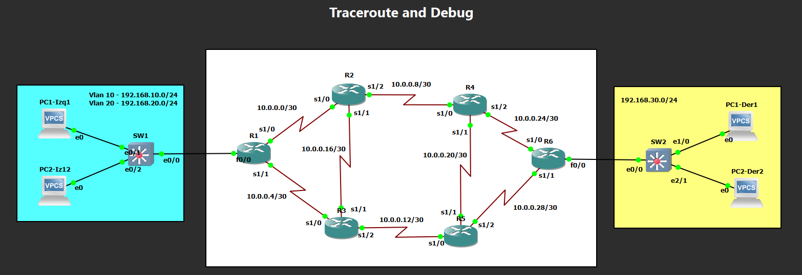

*Captura 01: topología en GNS3. A la izquierda, una LAN con dos VLAN (10 y 20) conectada a R1 mediante SW1; en el centro, seis routers con dos caminos redundantes entre R1 y R6; a la derecha, una LAN conectada a R6 mediante SW2.*

| Dispositivo | Función | Imagen utilizada |
|---|---|---|
| R1 a R6 | Routers (RIPv2) | `c7200-advipservicesk9-mz.152-4.S5.bin` |
| SW1, SW2 | Switches | `i86bi-linux-l2-ipbasek9-15.1g.bin` (IOL de capa 2) |
| PCs | Hosts | VPCS |

Los dos caminos entre las LAN son R1–R2–R4–R6 y R1–R3–R5–R6. Además hay dos enlaces cruzados (R2–R3 y R4–R5) que dan rutas alternativas adicionales. R4 es el router donde se configura SSH y se ejecuta el debug.

## 4. Direccionamiento

**Enlaces entre routers (/30)**

| Enlace | Red | Interfaces |
|---|---|---|
| R1 – R2 | 10.0.0.0/30 | R1 s1/0 ↔ R2 s1/0 |
| R1 – R3 | 10.0.0.4/30 | R1 s1/1 ↔ R3 s1/0 |
| R2 – R4 | 10.0.0.8/30 | R2 s1/2 ↔ R4 s1/0 |
| R3 – R5 | 10.0.0.12/30 | R3 s1/2 ↔ R5 s1/0 |
| R2 – R3 | 10.0.0.16/30 | R2 s1/1 ↔ R3 s1/1 |
| R4 – R5 | 10.0.0.20/30 | R4 s1/1 ↔ R5 s1/1 |
| R4 – R6 | 10.0.0.24/30 | R4 s1/2 ↔ R6 s1/0 |
| R5 – R6 | 10.0.0.28/30 | R5 s1/2 ↔ R6 s1/1 |

**LANs**

| LAN | Red | Gateway | Notas |
|---|---|---|---|
| VLAN 10 (izquierda) | 192.168.10.0/24 | R1 `Fa0/0.10` (192.168.10.1) | PC1-Izq1 |
| VLAN 20 (izquierda) | 192.168.20.0/24 | R1 `Fa0/0.20` (192.168.20.1) | PC2-Iz12 |
| Derecha | 192.168.30.0/24 | R6 `Fa0/0` | PC1-Der1, PC2-Der2 (host de prueba: 192.168.30.2) |

R1 usa **router-on-a-stick** con dos subinterfaces hacia SW1 (troncal). Todos los routers ejecutan **RIPv2**.

## 5. Verificación inicial

### Conectividad extremo a extremo

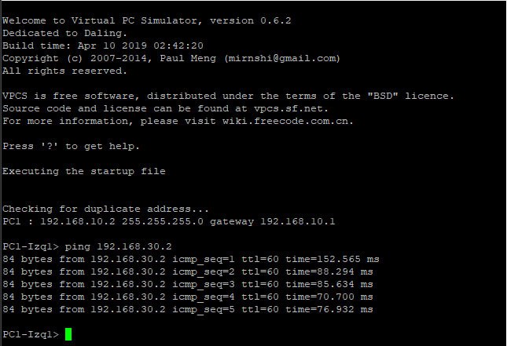

*Captura 02: ping desde PC1-Izq1 (192.168.10.2) hacia 192.168.30.2.*

- Los 5 paquetes recibieron respuesta.
- El **TTL de las respuestas es 60**: el paquete parte con TTL 64 y cruza 4 routers (R1, un router del camino superior o inferior, otro más, y R6), cada uno restando 1.

### Tabla de rutas en R1

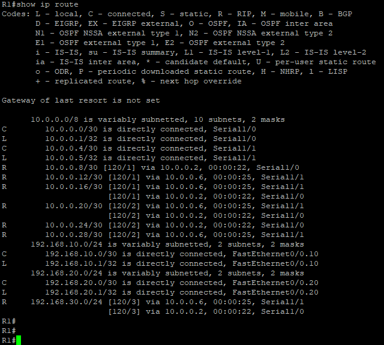

*Captura 03: `show ip route` en R1.*

- Las rutas aprendidas por RIP aparecen con `R` y distancia administrativa **120**.
- Para **192.168.30.0/24** existen **dos rutas con la misma métrica** (`[120/3]`): una por `10.0.0.6` (Serial1/1, hacia R3) y otra por `10.0.0.2` (Serial1/0, hacia R2). Esto es **balanceo de carga por costo igual**, y es lo que permite ver caminos distintos en el traceroute.

## 6. Práctica 1: Traceroute

### Traceroute desde un PC

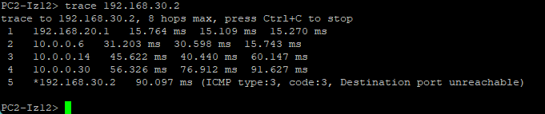

*Captura 04: `trace 192.168.30.2` desde PC2-Iz12 (VLAN 20).*

- Saltos: `192.168.20.1` (R1) → `10.0.0.6` (R3) → `10.0.0.14` (R5) → `10.0.0.30` (R6) → destino `192.168.30.2`.
- La última línea muestra el mensaje **ICMP tipo 3, código 3 (Destination port unreachable)**, enviado por el destino. Es la señal de que el paquete llegó al final.
- En este caso el PC siempre tomó el camino inferior (R3 y R5).

### Traceroute extendido desde R1 (origen VLAN 20)

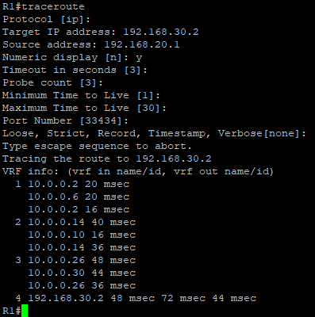

*Captura 05: `traceroute` extendido en R1 con destino 192.168.30.2, Source address 192.168.20.1 y Numeric display en `y`. El resto de parámetros se dejó por defecto (timeout 3 s, 3 sondas, TTL mínimo 1, TTL máximo 30, puerto 33434).*

### Traceroute extendido desde R1 (origen VLAN 10)

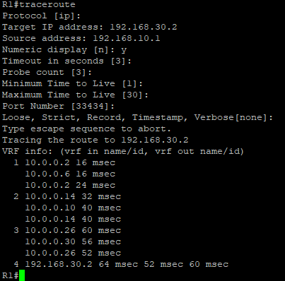

*Captura 06: el mismo traceroute con Source address 192.168.10.1.*

En ambas capturas se observa que las tres sondas de un mismo salto **no responden siempre desde el mismo router**:

| Salto | Respuestas | Interpretación |
|---|---|---|
| 1 | `10.0.0.2` y `10.0.0.6` | R2 y R3: las sondas se repartieron entre los dos caminos |
| 2 | `10.0.0.14` y `10.0.0.10` | R5 y R4 |
| 3 | `10.0.0.26` y `10.0.0.30` | R6, respondiendo por sus dos interfaces seriales |
| 4 | `192.168.30.2` | Destino |

Esto confirma lo visto en la tabla de rutas: existen **dos caminos de igual costo** y el router reparte el tráfico entre ambos. Con el traceroute simple desde un PC (captura 04) solo se ve uno de ellos.

## 7. Práctica 2: CPU base y acceso por SSH

### Uso de CPU en R4 antes del debug

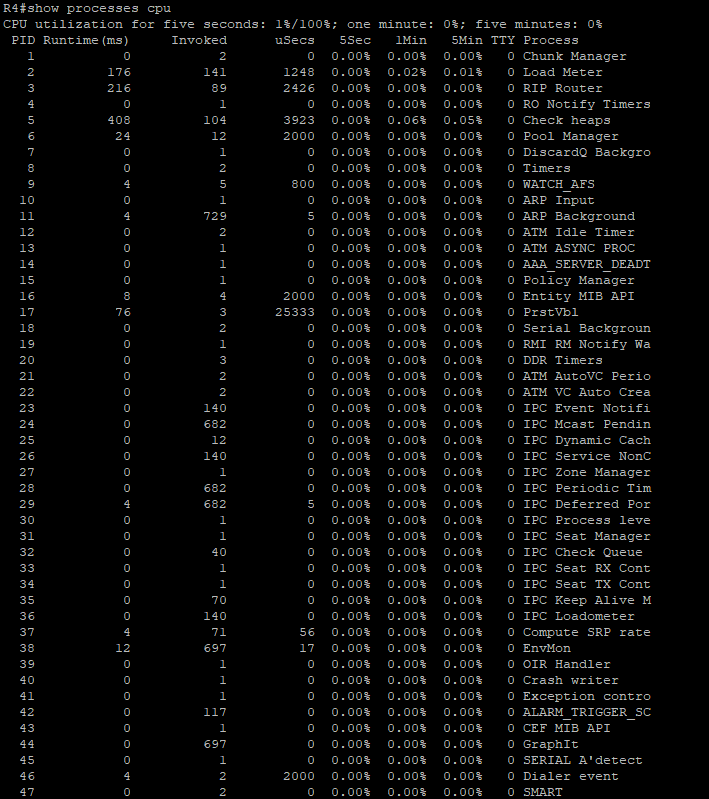

*Captura 07: `show processes cpu` en R4.*

- Uso de CPU: **1%** en 5 segundos, **0%** en 1 y 5 minutos.
- El proceso `RIP Router` acumuló 216 ms de tiempo de ejecución.

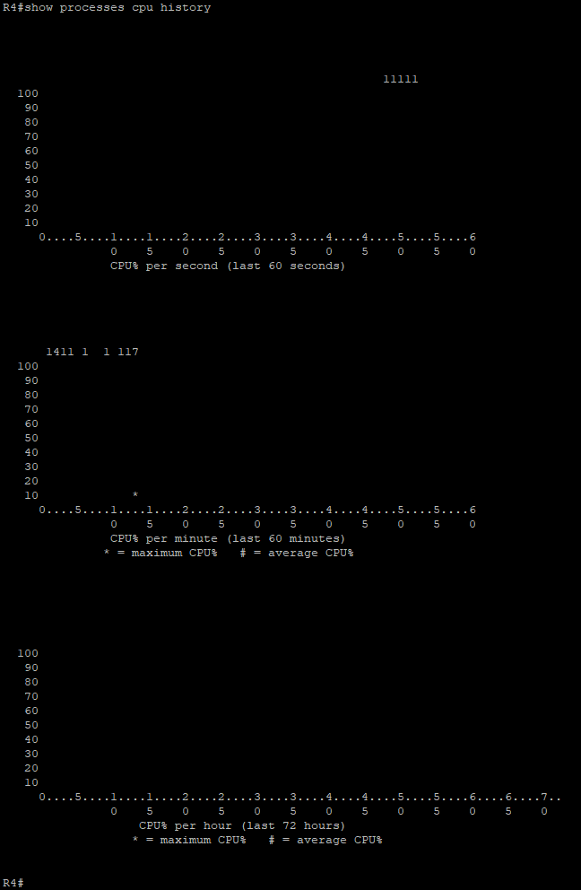

*Captura 07_2: `show processes cpu history` en R4. El uso se mantiene en valores muy bajos (alrededor de 1%).*

### Configuración de SSH en R4

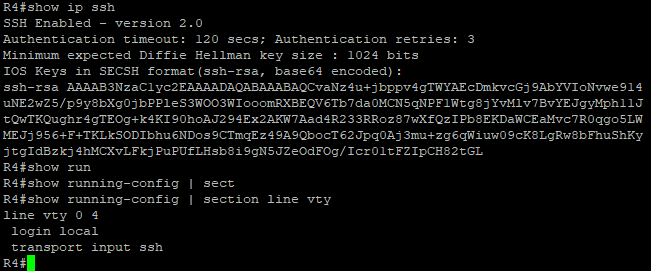

*Captura 08: `show ip ssh` y `show running-config | section line vty`.*

- **SSH habilitado, versión 2.0**, con tiempo de autenticación de 120 segundos y 3 reintentos.
- Las líneas VTY (`line vty 0 4`) usan `login local` y `transport input ssh`: solo se acepta SSH y se autentica con un usuario local.

### Conexión desde R1 hacia R4

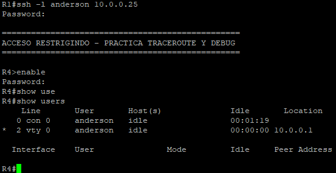

*Captura 09: `ssh -l anderson 10.0.0.25` desde R1 y `show users` en R4.*

- Se usa la IP **10.0.0.25** (la de R4 en el enlace hacia R6) y no una IP del enlace R2–R4. Así, cuando más adelante se apague ese enlace, R4 sigue siendo alcanzable por el otro camino.
- Tras el banner de acceso, `show users` muestra la sesión en **`vty 0`** originada desde `10.0.0.1` (R1), además de la sesión de consola.

## 8. Práctica 3: Debug y terminal monitor

### Debug activo, sin `terminal monitor`

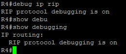

*Captura 10: `debug ip rip` y `show debugging` dentro de la sesión SSH.*

- El router confirma `RIP protocol debugging is on`, y `show debugging` lo lista como activo.
- Aun así, **no aparece ningún mensaje** en pantalla: los mensajes de debug van a la consola, no a la sesión remota.

### Debug con `terminal monitor`

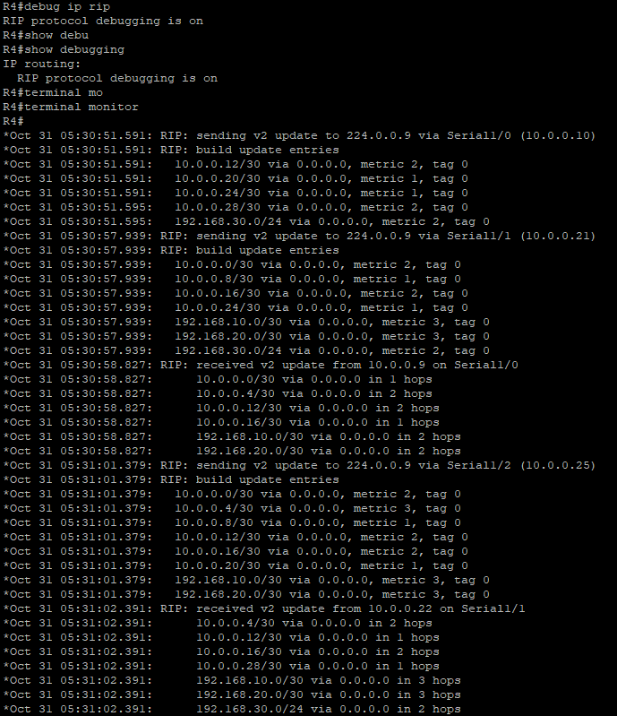

*Captura 11: se ejecuta `terminal monitor` y comienzan a mostrarse los mensajes de RIP.*

- R4 **envía** actualizaciones RIPv2 por multicast a **224.0.0.9** por sus tres interfaces seriales: `Serial1/0` (10.0.0.10), `Serial1/1` (10.0.0.21) y `Serial1/2` (10.0.0.25).
- R4 **recibe** actualizaciones de `10.0.0.9` (R2) por `Serial1/0` y de `10.0.0.22` (R5) por `Serial1/1`.
- Cada actualización lista las redes con su métrica (por ejemplo, `192.168.30.0/24` con métrica 2 hacia R2 y R5).
- Las actualizaciones periódicas se envían cada 30 segundos aproximadamente, por eso hay que esperar para verlas.

## 9. Práctica 4: Falla controlada de un enlace

Con el debug aún activo en R4, se apaga el enlace **R2–R4** desde R2.

### Apagado de la interfaz

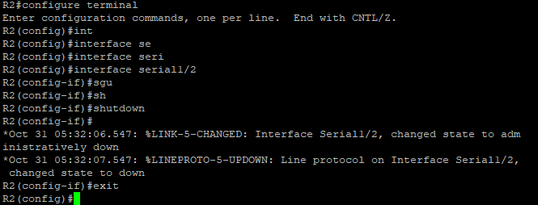

*Captura 12: `shutdown` en `Serial1/2` de R2.*

- El router informa que la interfaz pasó a *administratively down* y que el protocolo de línea cayó.

### Reacción de RIP en R4

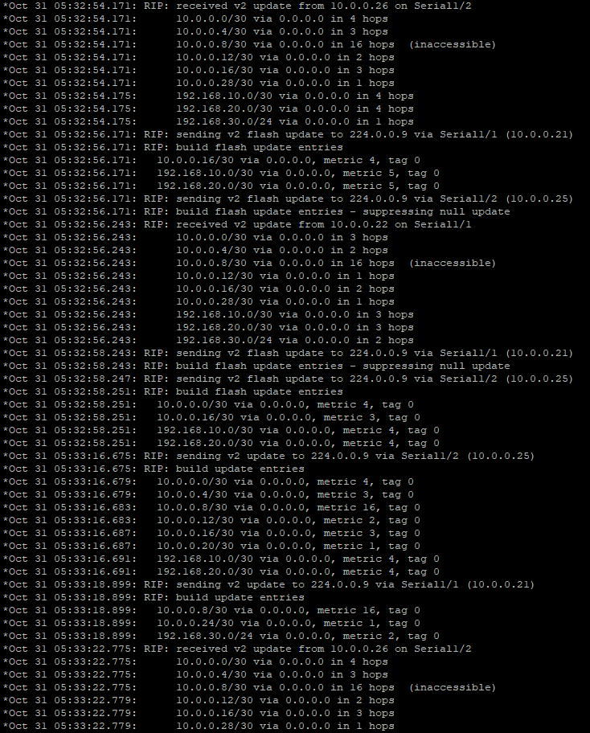

*Captura 13: salida del debug en R4 tras el apagado.*

- R4 recibe de R6 (`10.0.0.26`) una actualización donde **`10.0.0.8/30` aparece con 16 saltos (`inaccessible`)**: en RIP, la métrica 16 significa red inalcanzable.
- R4 envía **flash updates** (actualizaciones disparadas por el cambio, sin esperar los 30 segundos) y anuncia también `10.0.0.8/30` con métrica 16.
- La sesión SSH **siguió activa**: como R4 se alcanza por la IP 10.0.0.25, existe otro camino hasta ella.

### Efecto en el traceroute y en las rutas

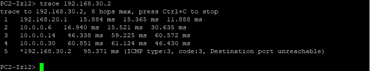

*Captura 14: `trace 192.168.30.2` desde PC2-Iz12 después del apagado.*

- El camino es el mismo de la captura 04 (R1 → R3 → R5 → R6). Es lo esperado: ese tráfico ya circulaba por el camino inferior, así que perder el enlace R2–R4 no lo modifica.

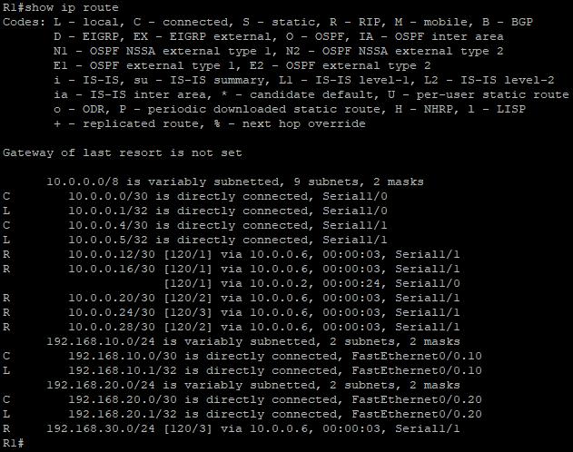

*Captura 14_2: `show ip route` en R1 después del apagado.*

- La tabla pasó de 10 a **9 subredes** en `10.0.0.0/8`: la red `10.0.0.8/30` desapareció.
- **192.168.30.0/24** ahora tiene **una sola ruta**, por `10.0.0.6` (Serial1/1, hacia R3).
- `10.0.0.24/30` pasó de métrica 2 (vía R2) a métrica **3** (vía R3), porque el camino es más largo.

## 10. Práctica 5: CPU final y restauración

### Uso de CPU en R4 después del debug

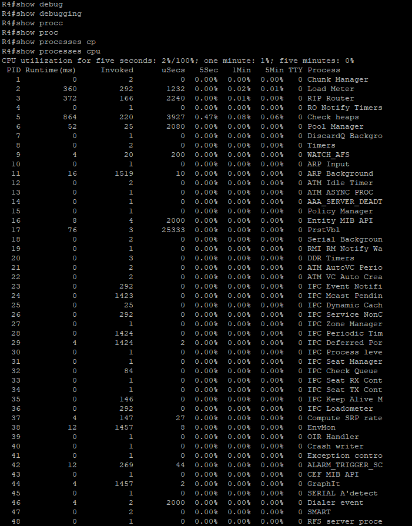

*Captura 15: `show debugging` (sin salida, el debug quedó apagado con `undebug all`) y `show processes cpu`.*

- Uso de CPU: **2%** en 5 segundos, **1%** en 1 minuto y **0%** en 5 minutos.
- El proceso `RIP Router` acumuló 372 ms de ejecución y 166 invocaciones (en la captura base: 216 ms y 89). Es un contador acumulado, por lo que crece con el tiempo y con la actividad de RIP.

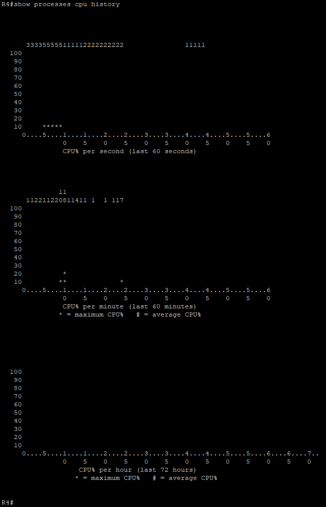

*Captura 15_2: `show processes cpu history` en R4.*

- En el gráfico por segundo aparecen valores de **3% a 5%**, mientras que en la captura base los valores eran de alrededor de 1%.
- El aumento coincide con el periodo de debug y reconvergencia de la red. Es pequeño porque la red es chica y está emulada; en un equipo real y con tráfico, un debug amplio como `debug ip packet` tendría un impacto mucho mayor.

### Restauración del enlace

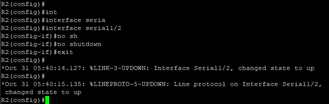

*Captura 16: `no shutdown` en `Serial1/2` de R2. La interfaz y el protocolo de línea vuelven a `up`.*

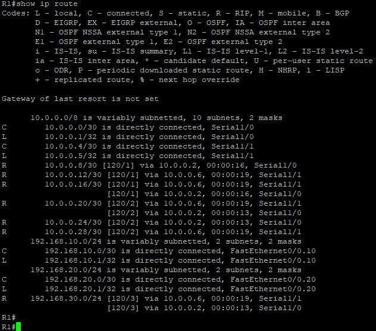

*Captura 16_2: `show ip route` en R1 tras restaurar el enlace.*

- Reaparece `10.0.0.8/30` (10 subredes de nuevo).
- **192.168.30.0/24** vuelve a tener **dos rutas de igual costo** (por `10.0.0.6` y por `10.0.0.2`): la red se recuperó sola gracias a RIP.

## 11. Conclusiones

- `traceroute` indica **por dónde** pasa el tráfico y ayuda a ubicar el tramo con problemas; `debug` ayuda a entender **por qué** ocurre dentro de un router. Se complementan.
- El traceroute extendido permite probar desde la perspectiva de otra red (*Source address*) y, con rutas de igual costo, deja ver los distintos caminos.
- Los mensajes de debug no aparecen en sesiones remotas hasta ejecutar `terminal monitor`.
- Con RIPv2, la caída de un enlace se propaga en pocos segundos mediante actualizaciones disparadas (métrica 16 = inalcanzable) y el tráfico se redirige por el camino alternativo.
- `debug` consume CPU: se usa acotado, por poco tiempo y se apaga con `undebug all`. En producción, `show processes cpu` y `show processes cpu history` sirven para medir el impacto antes y después.
- Elegir bien la IP de administración (aquí, 10.0.0.25 y no una del enlace que se iba a apagar) evita perder el acceso al equipo durante la falla.

## 12. Configuraciones

En la carpeta [`configs/`](configs/) se incluye la configuración completa de cada dispositivo, obtenida con `show running-config`:

| Archivo | Dispositivo |
|---|---|
| `R1.txt` a `R6.txt` | Routers R1 a R6 |
| `SW1.txt` | Switch de la LAN izquierda |
| `SW2.txt` | Switch de la LAN derecha |

Estos archivos permiten reproducir el laboratorio sin el proyecto de GNS3 (ver las notas siguientes).

## 13. Notas y limitaciones

- **Archivo del proyecto de GNS3 no incluido.** No se subió el archivo del proyecto (`.gns3` o la exportación portable `.gns3project`) porque GNS3 no permitió exportarlo: el proceso se quedaba bloqueado. Todo lo necesario para entender y reproducir el laboratorio está documentado en este README (topología, direccionamiento, comandos y capturas de cada paso) y en la carpeta `configs/`, que sirven como evidencia del trabajo realizado.
- **Máscara de las VLAN en R1.** El plan y los PCs usan `/24` para 192.168.10.0 y 192.168.20.0, pero por un descuido al configurar, las subinterfaces de R1 (`Fa0/0.10` y `Fa0/0.20`) quedaron con máscara `/30`, como se ve en las capturas de la tabla de rutas y del debug. El error se detectó **después de tomar las capturas**, por lo que se decidió dejarlas tal cual y documentarlo aquí. No afectó las pruebas porque los hosts utilizados y el gateway caen dentro del mismo /30; con la máscara correcta (`255.255.255.0`) se aprovecharía todo el rango de cada VLAN.
- **CPU en GNS3.** Los valores de CPU de un router emulado son bajos y no representan la carga de un equipo físico; sirven para practicar los comandos, no para medir rendimiento real.
- **Imágenes de IOS.** Los routers usan la imagen `c7200-advipservicesk9-mz.152-4.S5.bin` y los switches la `i86bi-linux-l2-ipbasek9-15.1g.bin`; ambas están en la carpeta de IOS del repositorio.
